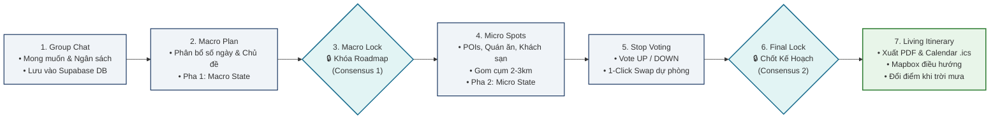
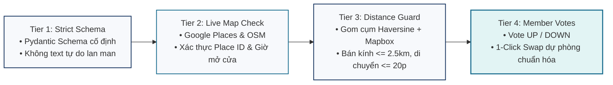

# 🚀 Project Overview — TripMate AI
### Intelligent Group Activity & Travel Planning Platform (Unified AI Agent & Cloud Architecture)

> [!NOTE]
> **Tóm Tắt Dự Án (Executive Summary)**:  
> **TripMate AI** là nền tảng cộng tác lập kế hoạch thông minh dành cho nhóm (2--10 người) đi chơi cuối tuần hoặc du lịch nhiều ngày (Việt Nam & các nước Đông Nam Á miễn thị thực). Hệ thống giải quyết triệt để tình trạng tranh cãi kéo dài và quá tải cho trưởng nhóm bằng việc kết hợp phòng cộng tác thời gian thực với **mô hình AI Agent hợp nhất (DeepSeek-V4)** chạy trên **LangGraph Python**, hoạt động theo **Quy trình đồng thuận 2 giai đoạn (Two-Stage Consensus Planning Flow)** và **Hàng rào kiểm chứng thực tế 4 tầng (Four-Tier Grounding Pipeline)** để đảm bảo 0% địa điểm ảo. Nền tảng được kiến trúc sẵn sàng cho môi trường đám mây thực tế kết hợp **Vercel, Render, Supabase và Upstash Redis**.

---

## 💔 1. Nỗi Đau Thực Tế (Pain Points in Group Trip Planning)

Lên kế hoạch đi chơi hoặc du lịch cùng nhóm bạn bè luôn gặp phải 3 rào cản lớn:

| Nỗi đau | Biểu hiện thực tế | Hậu quả kỹ thuật & tâm lý |
|---|---|---|
| 📱 **Phân mảnh công cụ (Tool Fragmentation)** | Người dùng phải nhảy qua lại giữa 5+ ứng dụng rời rạc: Google Maps, Google Search, TripAdvisor, Airbnb, Trip.com, Hotels.com, Expedia, chat Messenger/Zalo. | Mất tập trung, dữ liệu rời rạc, không có một nguồn sự thật duy nhất (Single Source of Truth). |
| ⚡ **Bế tắc sở thích & Xung đột ngầm (Preference Deadlocks)** | Mâu thuẫn về ngân sách (người muốn tiết kiệm, người thích sang chảnh), khẩu vị ẩm thực, giờ giấc sinh hoạt. | Thảo luận kéo dài 2--3 ngày không đi đến hồi kết, dễ dẫn đến "hủy kèo". |
| 🎒 **Kiệt sức Trưởng nhóm & Trôi ngữ cảnh (Organizer Burnout & Buried Context)** | Các bình chọn, link quán ăn và ý kiến bị trôi mất dưới hàng trăm tin nhắn chat. Một người phải ôm đồm việc tổng hợp và sửa lịch trình. | Trưởng nhóm quá tải và mệt mỏi; nhóm thiếu sự đồng thuận thực sự. |

---

## 🎯 2. Đối Tượng Người Dùng & Phạm Vi Thực Tế (Target Users & Scope)

- **Đối tượng người dùng mục tiêu**: Các nhóm nhỏ từ **2 đến 10 thành viên** (nhóm bạn thân, sinh viên đại học, đồng nghiệp công ty) lên kế hoạch cho các buổi đi chơi cuối tuần trong ngày hoặc các kỳ nghỉ du lịch ngắn/dài ngày.
- **Phạm vi thực tế (Practical Scope)**: Tập trung vào du lịch nội địa tại Việt Nam và các điểm đến miễn thị thực (visa-free) trong khối ASEAN. Hệ thống tập trung tối đa vào bài toán **sắp xếp lịch trình thông minh, tối ưu cụm địa lý (geo-clustering) và cộng tác thời gian thực** mà không bị vướng vào các thủ tục visa phức tạp.

---

## 💡 3. Giải Pháp: Quy Trình Đồng Thuận 2 Giai Đoạn (Two-Stage Consensus Planning Flow)

TripMate AI hợp nhất toàn bộ trải nghiệm nhóm vào một phòng cộng tác duy nhất, được điều phối bởi **AI Agent hợp nhất (DeepSeek-V4)** dẫn dắt nhóm qua hai chốt chặn đồng thuận minh bạch:

### Chi tiết các bước thực hiện:
1. **Thu thập mong muốn (Desires Capture)**: Thành viên chat tự do về ngày đi, khung ngân sách, phong cách chuyến đi; tin nhắn được lưu trực tiếp vào Supabase (`core` schema).
2. **Đồng thuận Vĩ mô (Macro Consensus - Consensus 1)**: AI Agent (Phase 1 Macro State) phác thảo số ngày và chủ đề từng ngày mà **chưa gọi các API địa điểm tốn kém**. Cả nhóm thảo luận và Host bấm khóa khung chương trình.
3. **Tuyển chọn Chi tiết & Bình chọn Điểm dừng (Micro Curation & Stop Voting)**: AI Agent (Phase 2 Micro State) truy vấn hệ thống API tổng hợp (Google Maps/Places, Google Search, Google Hotels, TripAdvisor, Airbnb, Trip.com, Hotels.com, Trivago, Expedia, Klook), gom cụm địa lý trong bán kính $2.0$--$2.5$\,km ($\le 20$\,phút di chuyển). Thành viên vote UP/DOWN cho từng điểm dừng, hỗ trợ đổi địa điểm dự phòng trong 1 click (**1-Click Swap**).
4. **Chốt Kế Hoạch Chính Thức (Final Confirmation - Consensus 2)**: Host xác nhận kế hoạch hoàn chỉnh, lưu các bản ghi đã chuẩn hóa vào bảng `plan_stops` trong PostgreSQL, sinh file PDF và lịch (.ics), kích hoạt bản đồ lộ trình Mapbox GL.
5. **Lịch trình Sống Động (Living Itinerary & Dynamic Adaptation)**: Kế hoạch không bị đóng băng cứng nhắc. Khi có biến động thực tế (ví dụ trời mưa bất chợt), thành viên chat yêu cầu đổi quán cafe trong nhà gần đó, AI chỉ cập nhật duy nhất 1 dòng trong bảng `plan_stops` mà không làm xáo trộn toàn bộ lịch trình.

---

## ⭐ 4. Tính Năng Nền Tảng & Trải Nghiệm Người Dùng (Platform Features)

### 4.1. Hai Phạm Vi Kế Hoạch Linh Hoạt (Dual Planning Scopes)
- **Đi chơi trong ngày (Day Hangouts)**: Dành cho các buổi hẹn hò, cafe, ăn uống, tụ tập cuối tuần ngẫu hứng (*"cafe $\rightarrow$ board game $\rightarrow$ lẩu"*), ưu tiên các địa điểm đang mở cửa với thời gian di chuyển ngắn nhất.
- **Kỳ nghỉ nhiều ngày (Multi-Day Vacations)**: Lịch trình du lịch hoàn chỉnh (*"4 ngày tại Đà Nẵng & Hội An"*) kết hợp gợi ý khách sạn, địa điểm ăn uống đặc sản, điểm tham quan và lộ trình di chuyển tối ưu theo ngày.

### 4.2. Phòng Cộng Tác Chung & Bản Đồ Sống (Shared Room & Live Map Canvas)
- **Mời qua Link & Phân Quyền**: Vào phòng tức thì qua link chia sẻ. Phân định rõ quyền **Host** (khóa kế hoạch, cài đặt phòng) và **Member** (chat, vote điểm dừng, swap địa điểm dự phòng).
- **Dòng Thời Gian Tương Tác & Mapbox GL**: Các thẻ điểm dừng trực quan hiển thị hình ảnh thực tế, giờ mở cửa, thời lượng ước tính và lộ trình định tuyến trực tiếp trên nền Mapbox.

### 4.3. Động Cơ Đồng Thuận 2 Tầng (Two-Tier Consensus Engine)
- **Tầng 1 (Macro Approval)**: Khóa khung chương trình trước khi gọi các API tốn kém token và chi phí.
- **Tầng 2 (Micro Stop Voting)**: Bình chọn từng điểm dừng. Điểm dừng bị vote DOWN lập tức hiển thị 2 phương án thay thế đã được nạp sẵn (pre-fetched) để swap chỉ trong 1 click.

### 4.4. Chuẩn Giao Diện: Flexbox & Fully Responsive UI (Mobile-First)
- **Bố cục Flexbox & Grid Hiện Đại**: Áp dụng triệt để `display: flex` và CSS Grid cho toàn bộ layout (Timeline, Chat, Voting Cards, Navbar, Modal).
- **Đáp ứng mọi kích thước (Multi-Screen Breakpoints)**: Tối ưu liền mạch từ Mobile (375px+), Tablet (768px+) đến Desktop/Màn hình lớn (1024px+ / 1440px+).
- **Adaptive Split-Pane & Drawer Layout**: Trên mobile hiển thị bottom-sheet / drawer vuốt mượt mà; trên desktop chuyển thành giao diện chia 3 cột (Chat - Interactive Timeline - Mapbox GL) không gây giật lag và zero layout shift (CLS < 0.1).
- **Chuẩn Công Thái Học & Tiếp Cận (WCAG AA)**: Kích thước vùng bấm chạm tối thiểu $44 \times 44$\,px trên mobile, độ tương phản văn bản chuẩn $\ge 4.5:1$.

---

## 🤖 5. Kiến Trúc AI Agent Hợp Nhất & Hàng Rào Chống Ảo Giác (Grounding Pipeline)

### 5.1. Unified AI Agent (DeepSeek-V4) với Two-Phase State Execution
Thay vì chia thành nhiều sub-agent rời rạc gây nghẽn độ trễ và khó kiểm thử, TripMate AI sử dụng **một AI Agent hợp nhất duy nhất chạy DeepSeek-V4 trên nền LangGraph Python**, thực thi qua 2 pha trạng thái:
- **Phase 1 (Macro Planning State)**: Đề xuất ngày đi, nhịp độ và chủ đề hàng ngày mà không gọi API du lịch bên ngoài, tiết kiệm tối đa token cho đến khi đạt đồng thuận vĩ mô.
- **Phase 2 (Micro Curation State)**: Kích hoạt sau khi có Macro Approval. Thực thi các lệnh gọi công cụ ngoài, áp dụng gom cụm địa lý bán kính $2.0$--$2.5$\,km để tránh lộ trình ziczac, và chuẩn bị sẵn các điểm dừng thay thế.
- **Model Abstraction Layer**: Xây dựng trên nền tảng LangChain/LangGraph model abstraction. DeepSeek-V4 là động cơ suy luận chính, hỗ trợ fallback mượt mà sang OpenAI (GPT-4o), Anthropic Claude, hoặc Google Gemini để phòng tránh rủi ro phụ thuộc một nhà cung cấp (vendor lock-in).
- **Typed State Persistence**: Lưu vết checkpoint của `AgentState` vào PostgreSQL thông qua `AsyncPostgresSaver` kết nối qua Data Access Layer (DAL) có xác thực.

### 5.2. Four-Tier Grounding Pipeline (Hàng Rào 4 Tầng Loại Bỏ Ảo Giác AI)

1. **Tier 1 (Strict Schema)**: Ràng buộc đầu ra của AI theo Pydantic schema nghiêm ngặt (tên địa điểm, danh mục, thời lượng dừng, phân khúc giá), ngăn chặn việc sinh text lan man hoặc thiếu trường dữ liệu.
2. **Tier 2 (Live Map Check)**: Xác thực từng địa điểm qua các API đối tác và tìm kiếm: **Google Places (Google Maps), Google Search, Google Hotels, TripAdvisor, Airbnb, Trip.com, Hotels.com, Trivago, Expedia** để đảm bảo địa điểm có thật 100%, có giá phòng thực tế, đang mở cửa và đúng giờ hoạt động.
3. **Tier 3 (Distance Guard)**: Áp dụng công thức khoảng cách Haversine và Mapbox định tuyến, đảm bảo các điểm dừng trong cùng một buổi sáng/chiều nằm trong bán kính $\le 2.5$\,km và thời gian di chuyển $\le 20$\,phút.
4. **Tier 4 (Member Votes & 1-Click Swap)**: Thành viên nhóm trực tiếp vote UP/DOWN; các điểm dừng bị phản đối lập tức được thay thế bằng phương án dự phòng đã được xác thực sẵn.

---

## ☁️ 6. Kiến Trúc Điện Toán Đám Mây & Hạ Tầng Triển Khai (Cloud Deployment)

Hệ thống được thiết kế theo kiến trúc phi tập trung, phân bổ tải tối ưu trên các nền tảng đám mây hiện đại:

- **Frontend (Vercel Edge CDN)**: React 18 SPA + TypeScript được phân phối trên mạng lưới Global Edge CDN của Vercel, thời gian nạp trang dưới 100ms trên toàn cầu, không có độ trễ khởi động lạnh (zero cold-start), hỗ trợ Preview Deployments cho từng PR.
- **Backend Gateway (Render.com Web Service)**: FastAPI ASGI application (Python 3.11+) xử lý RESTful endpoints và WebSocket room server. Được cấu hình cron ping tự động tới `/api/healthz` để ngăn service rơi vào trạng thái ngủ khi đang trong phiên lập kế hoạch.
- **AI Agent Worker (Render.com Background Worker)**: Tiến trình LangGraph Python chạy độc lập, giới hạn bộ nhớ $\le 512$\,MB RAM, tiêu thụ tác vụ bất đồng bộ từ hàng đợi Redis Streams (`XREADGROUP`).
- **Database & BaaS (Supabase)**: Managed PostgreSQL 16 tích hợp extension `pgvector`, chia tách 3 schema độc lập:
  - `core`: Lưu trữ users, events, event_members, plans, plan_stops, plan_votes, chat_messages, expenses.
  - `checkpoints`: Lưu trạng thái `AgentState` của LangGraph qua `AsyncPostgresSaver`.
  - `vectors`: Lưu trữ vector embeddings phục vụ tra cứu địa điểm tương tự.
  - **Supavisor Connection Pooler (port 6543, Transaction Mode)**: Ghép hơn 200 phiên client qua 15 kết nối cơ sở dữ liệu vật lý, đảm bảo không bao giờ cạn kiệt connection pool.
  - **Row Level Security (RLS)**: Cách ly dữ liệu nhiều người dùng ở cấp độ database.
- **Queue & Cache (Upstash Redis)**: Serverless Redis 7 quản lý:
  - **Redis Streams (`XADD`)**: Đẩy tác vụ sinh kế hoạch bất đồng bộ từ Gateway sang AI Worker mà không block người dùng.
  - **Redis Pub/Sub (`plan:updated`)**: Đồng bộ sự kiện cập nhật kế hoạch tới tất cả các instance FastAPI Gateway để broadcast qua WebSockets.
  - **L2 Cache (TTL 24h)**: Lưu trữ kết quả truy vấn địa điểm từ Google Places API để giảm chi phí và chống rate limit.
- **Độ Bền & Khả Năng Kháng Lỗi (PyBreaker Resilience)**: Mọi lệnh gọi API du lịch & khách sạn bên thứ 3 (**Google Maps/Places, Google Search, Google Hotels, TripAdvisor, Airbnb, Trip.com, Hotels.com, Trivago, Expedia, Klook, 12Go Asia**) đều được quản lý qua Adapter Pattern và bọc bởi **PyBreaker Circuit Breaker** với timeout 2.5 giây; khi có sự cố mạng hoặc lỗi API, hệ thống tự động ngắt mạch và chuyển sang dữ liệu cache/DB fallback.
- **Giám Sát & Truy Vết (Observability)**: Tích hợp **OpenTelemetry** truy vết phân tán xuyên suốt luồng Client $\rightarrow$ Gateway $\rightarrow$ Redis $\rightarrow$ AI Worker $\rightarrow$ Supabase $\rightarrow$ WebSocket, và **LangSmith** theo dõi chất lượng prompt của LLM.

---

## 📊 7. Mục Tiêu Hiệu Năng & Tiêu Chí Đánh Giá (System Targets & KPIs)

### 7.1. Ngân Sách Độ Trễ (Latency Budget)
- **Phản hồi thao tác người dùng (User Action / Vote ACK)**: $< 80$\,ms qua WebSocket với atomic database update.
- **Streaming token AI đầu tiên (TTFT)**: $< 800$\,ms để người dùng thấy phản hồi tức thì, không nhìn màn hình trắng.
- **Soạn thảo Roadmap Vĩ mô (Macro Drafting)**: $6$--$12$\,giây (Pha 1 LangGraph).
- **Tuyển chọn Chi tiết (Micro Grounding)**: $10$--$20$\,giây (Pha 2 LangGraph kèm kiểm tra Google Places song song).
- **Đổi địa điểm 1-Click Swap**: $< 500$\,ms TTFT, hoàn thành trong $3$--$6$\,giây.

### 7.2. Tải & Năng Lực Phục Vụ (Capacity Targets)
- **Đồng thời (Concurrency)**: Hỗ trợ $50$--$100$ người dùng hoạt động đồng thời (CCU) trải đều trên $10$--$20$ phòng lập kế hoạch hoạt động song song ($3$--$6$ người/phòng).
- **Thông lượng (Throughput)**: $150$--$250$\,requests/giây trên FastAPI gateway; $5$--$8$ tác vụ AI Agent xử lý song song với bộ đệm hàng đợi Redis Streams.
- **Lưu trữ**: Hơn $30,000$ chuyến đi được lưu trữ trong PostgreSQL; 200+ kết nối client qua Supavisor pooler (port 6543).

### 7.3. Tiêu Chí Đánh Giá Thành Công (Evaluation Targets)
- **Độ chính xác AI (AI Grounding Accuracy)**: $\ge 98\%$ địa điểm được xác thực trên Google Places với Place ID hợp lệ ($0\%$ địa điểm ảo); $\ge 95\%$ tuân thủ ràng buộc khoảng cách ($\le 2.5$\,km) và ngân sách.
- **Tốc độ đạt đồng thuận (Consensus Speed)**: Rút ngắn thời gian chốt kế hoạch nhóm từ $2$--$3$\,ngày tranh cãi xuống **dưới 15 phút**; $\ge 85\%$ điểm dừng được chấp thuận ngay từ lượt đề xuất đầu tiên.
- **Độ sẵn sàng hệ thống (System Health)**: Uptime $\ge 99.5\%$; độ trễ đồng bộ WebSocket giữa nhiều người dùng trong cùng một phòng $< 100$\,ms.

### 7.4. Chuẩn Kỹ Thuật: Architecture Pattern, Modular Design & Tiêu Chí Kỹ Thuật (Dễ Maintain, Dễ Dev, Dễ Hiểu)
- **Architecture Pattern (Kiến Trúc Phân Tầng Chuẩn Mực)**:
  - **Backend (Layered Clean Architecture / Modular Monolith)**: Phân tách tuyệt đối 4 tầng: API Routers (FastAPI) $\rightarrow$ Business Domain Services $\rightarrow$ Data Access Layer (DAL/Repository SQLAlchemy 2.0 Async) $\rightarrow$ External Provider Adapters (Adapter & Strategy Pattern).
  - **Frontend (Component-Driven Architecture - CDA)**: Áp dụng Feature-Sliced Design (`features/`), phân tách rành mạch: Pure Presentation Components $\rightarrow$ Container/Custom Hooks $\rightarrow$ Global Stores (Zustand) $\rightarrow$ Service Clients (TanStack Query + MSW).
- **Modular Design (Thiết Kế Mô-Đun Hóa)**:
  - **High Cohesion & Low Coupling**: Mỗi module nghiệp vụ độc lập, giao tiếp thông qua hợp đồng chuẩn (Typed Pydantic Schemas & TypeScript Interfaces), triệt tiêu circular dependencies.
  - **Pluggable Travel Provider Architecture**: Đóng gói toàn bộ các API khách sạn & địa điểm (**Google Maps, Google Search, Google Hotels, TripAdvisor, Airbnb, Trip.com, Hotels.com, Trivago, Expedia**) qua interface trừu tượng `BaseTravelProvider`. Thêm/bớt nhà cung cấp mà không sửa core business.
- **Bộ Ba Tiêu Chí Công Kỹ Nghệ Hàng Đầu**:
  - 🛠️ **Dễ Maintain**: Tuân thủ triệt để nguyên lý SOLID, DRY, hàm ngắn gọn ($\le 30$ dòng), cấu trúc file tường minh, tự động ngắt mạch kháng lỗi qua PyBreaker.
  - 💻 **Dễ Dev (Developer Experience - DX)**: Quy trình Contract-First, tự động sinh OpenAPI spec, Mock Service Worker (MSW) cho phép FE & BE lập trình song song từ Sprint 0, Hot Module Replacement (Vite), 100% Type-Safety.
  - 📖 **Dễ Hiểu**: Mã nguồn tự dẫn giải (Self-documenting code), chuẩn đặt tên rõ nghĩa, kiến trúc tài liệu Docs-as-Code bám sát 100% Technical Proposal.

---

## 👥 8. Mô Hình Phân Công 6 Thành Viên & Nguyên Tắc Docs-as-Code

Dự án được phân bổ đồng đều cho 6 thành viên phụ trách 6 mảng kỹ thuật cốt lõi:

| Track | Thành viên | Vai trò kỹ thuật theo Proposal | File theo dõi cá nhân |
|---|---|---|---|
| **BE-Core & DAL** | **Tạ Quang Huy** | Thiết kế Schema DB gốc Supabase, Event/Room CRUD, Two-Stage Consensus APIs, RolesGuard, LangGraph DAL Bridge, WebSocket Room Server | [person-1-backend-core.md](../04-tasks/person-1-backend-core.md) |
| **BE-Platform & FE-Core** | **Hà Đăng Huy** | External Travel APIs (Places, Agoda, Klook), PyBreaker Circuit Breaker, Upstash Redis Cache, React 18 Core UI, Auth, Mapbox GL Canvas | [person-2-backend-platform.md](../04-tasks/person-2-backend-platform.md) / [person-4-frontend-core.md](../04-tasks/person-4-frontend-core.md) |
| **BE-Services** | **Phạm Đình Ánh Dương** | Supabase Auth Integration, Link Invitations, Notification Services, PDF & Calendar (.ics) Export, Quản lý tài chính & Optimal Settlement | [person-2-backend-platform.md](../04-tasks/person-2-backend-platform.md) |
| **FE-Growth** | **Nguyễn Minh Đức** | Realtime Room Chat & AI Streaming UI, Interactive Timeline, Stop Voting Cards (1-Click Swap), Design System, Shared Expenses UI | [person-5-frontend-growth.md](../04-tasks/person-5-frontend-growth.md) |
| **AI Lead** | **Nguyễn Tùng Dương** | Unified AI Agent Architecture, Two-Phase State Machine, Model Abstraction Layer, Four-Tier Grounding Pipeline, Geo-Clustering | [person-3-ai-engineer.md](../04-tasks/person-3-ai-engineer.md) |
| **DevOps & Security** | **Đinh Tiến Luân** | Multi-Cloud Deployment (Vercel + Render + Supabase), CI/CD GitHub Actions, OpenTelemetry Tracing, Pentest OWASP Top 10, Concurrency Benchmark | [person-6-security-devops.md](../04-tasks/person-6-security-devops.md) |

> 📜 **Cam kết thực thi chất lượng**: Toàn bộ 6 thành viên thực hiện nghiêm ngặt nguyên tắc **"No Docs = Not Done & No Merge"**. Bất kỳ ai sửa đổi code logic hay cơ chế hệ thống đều phải cập nhật tài liệu kỹ thuật và đánh dấu tracking tiến độ trên task board tương ứng.
