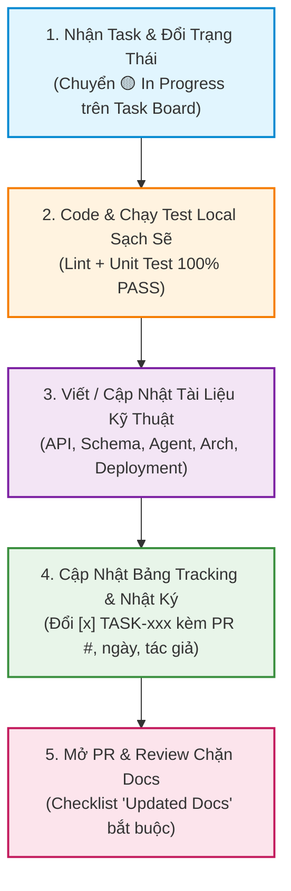

# 📝 Quy Trình Viết Tài Liệu & Tracking Dự Án (Post-Task Docs & Progress Tracking)

> **Nguyên tắc cốt lõi của dự án**: **"No Docs = Not Done & No Merge"** (Chưa viết tài liệu & chưa cập nhật tracking = Chưa hoàn thành task và không được duyệt PR).  
> Mọi thành viên trong nhóm 6 người (**Tạ Quang Huy, Hà Đăng Huy, Phạm Đình Ánh Dương, Nguyễn Minh Đức, Nguyễn Tùng Dương, Đinh Tiến Luân**) đều **bắt buộc** phải viết tài liệu và cập nhật tracking cho mọi dòng code và task của mình.

---

## ⚡ 1. Vì Sao Ai Cũng Phải Viết Docs & Tracking?

Trong một dự án gồm 6 thành viên triển khai song song kiến trúc Cloud + AI Agent phức tạp (Vercel, Render, Supabase, Upstash Redis, LangGraph DeepSeek-V4), việc **viết tài liệu và cập nhật tiến độ đồng bộ** giải quyết các vấn đề sống còn:
1. **Không ai bị mù thông tin**: Nhìn vào bảng task và docs là biết ai đang làm gì, module nào đã hoàn thành, endpoint nào đã sẵn sàng gọi thật.
2. **Minh bạch hóa đóng góp**: Mọi thành viên đều có bằng chứng lịch sử rõ ràng về công việc mình làm (mã task `TASK-xxx`, file code đã sửa, file docs đã viết, pull request đã merge).
3. **Tránh conflict kiến trúc**: Khi đổi DB Schema, Contract API hoặc State của AI Agent, người đổi phải cập nhật docs ngay lập tức để 5 thành viên còn lại không code sai hướng.
4. **Bàn giao trơn tru**: Khi có người bị ốm hoặc cần nhờ người khác hỗ trợ, người tiếp nhận chỉ cần đọc docs của task đó là bắt tay vào code được ngay.

---

## 🧭 2. Chu Trình Bắt Buộc Khi Làm Bất Kỳ Task Nào (The 5-Step Loop)

Mỗi thành viên khi nhận một mã task (`TASK-xxx`) từ Sprint Backlog bắt buộc tuân thủ quy trình 5 bước khép kín sau:



### Bước 1: Nhận Task & Đổi Trạng Thái Trên Board
- Mở file task cá nhân (`docs/04-tasks/person-X-*.md`) và `docs/04-tasks/task-board.md`.
- Đổi trạng thái từ `🔲 To Do` sang `🟡 In Progress`.
- Tạo nhánh git theo chuẩn: `git checkout -b feature/TASK-xxx-mo-ta-ngan` (xem [branch-naming.md](branch-naming.md)).

### Bước 2: Code Logic & Chạy Test Local
- Code tuân thủ coding convention (`docs/02-standards/coding-conventions.md`).
- **Backend**: Chạy `poetry run ruff check .` và `poetry run pytest` (đảm bảo test pass 100%).
- **Frontend**: Chạy `pnpm run lint` và `pnpm run test` (hoặc `pnpm run build`).

### Bước 3: Viết / Cập Nhật Tài Liệu Kỹ Thuật (Docs-as-Code)
Tra cứu bảng ở **Mục 3** để biết chính xác bạn phải viết / sửa file tài liệu nào tương ứng với nội dung code vừa làm.

### Bước 4: Đánh Dấu Hoàn Thành & Ghi Nhật Ký Tracking
- Mở file task cá nhân (`docs/04-tasks/person-X-*.md`) và master board (`docs/TASKS.md` + `docs/04-tasks/task-board.md`).
- Chuyển `[ ]` thành `[x]` và ghi rõ định dạng tracking:
  ```markdown
  - [x] **`TASK-xxx`** **Tên task** *(PR #12 - @NguyenMinhDuc - 22/09/2026)*
  ```
- Nếu task có thay đổi so với dự kiến ban đầu, ghi chú tóm tắt 1 dòng lý do kỹ thuật ngay dưới task.

### Bước 5: Mở PR Kèm Docs & Reviewer Thực Hiện Kiểm Tra Chặn
- Mở Pull Request sử dụng template [PULL_REQUEST_TEMPLATE.md](../../.github/PULL_REQUEST_TEMPLATE.md).
- Điền đầy đủ mục **`## 📚 Updated Docs`**.
- Reviewer có quyền bấm **Request Changes** nếu PR có code mới mà không có thay đổi docs tương ứng.

---

## 🗂️ 3. Ma Trận Tra Cứu: "Tôi Vừa Code Gì ➔ Bắt Buộc Sửa Docs Nào?"

| Loại công việc vừa thực hiện | File tài liệu kỹ thuật bắt buộc cập nhật | Nội dung tài liệu tối thiểu phải viết |
|---|---|---|
| 🔌 **Thêm / Sửa REST API hoặc WebSocket** | `docs/02-standards/api-design-guide.md` | Endpoint URL, Method, Auth Guard, Request Body Schema, Response JSON sample, Error codes (400, 401, 403, 404, 422). |
| 🗄️ **Thêm / Sửa PostgreSQL Model / Migration** | `docs/03-architecture/database-schema.md` | Tên bảng, schema (`core`/`checkpoints`/`vectors`), cột, kiểu dữ liệu, quan hệ FK, indexes, RLS policies, file Alembic migration. |
| 🤖 **Sửa AI Agent / LangGraph / Prompts** | `docs/03-architecture/ai-agent-architecture.md`<br>`explain.md` | Node LangGraph mới, Two-Phase State changes, Pydantic Schema, prompt versioning, Four-Tier Grounding, model fallback. |
| 🎨 **Thêm Màn Hình / Component UI / Flow mới** | `docs/06-design/user-flows.md`<br>`frontend/src/mocks/handlers/` | Mô tả luồng tương tác, route URL, wireframe/layout component, mock MSW handler tương ứng để người khác test. |
| 🚢 **Cấu hình Cloud / DevOps / Docker / Secrets** | `docs/03-architecture/deployment-guide.md`<br>`.env.example`<br>`docs/05-security/security-guidelines.md` | Biến môi trường mới kèm giá trị mẫu, hướng dẫn deploy Render/Vercel/Supabase, cấu hình rate limit, cơ chế bảo mật. |
| ⚖️ **Quyết định Kỹ thuật Lớn (Kiến trúc)** | `docs/03-architecture/adr/ADR-xxx.md` | File ADR giải thích: Bối cảnh, các lựa chọn xem xét, lý do chọn giải pháp này, hệ quả tích cực/tiêu cực. |
| ✅ **HOÀN THÀNH BẤT KỲ TASK NÀO** | `docs/04-tasks/person-X-*.md`<br>`docs/TASKS.md`<br>`docs/04-tasks/task-board.md` | Tick `[x]` kèm thông tin PR, tên người làm, ngày hoàn thành để toàn đội theo dõi tiến độ thời gian thực. |

---

## 📋 4. Quy Chuẩn Báo Cáo Tracking Hàng Ngày & Hàng Tuần (Daily & Weekly Sync)

Để đảm bảo không ai bị tụt lại và tiến độ được kiểm soát từng ngày:

### 4.1. Báo Cáo Async Hàng Ngày (Daily Standup qua Discord / Slack `#daily-sync`)
Mỗi ngày trước **10:00 sáng**, từng thành viên gửi tin nhắn 3 dòng ngắn gọn:
```
[Họ Tên] - [Vai trò] - [Ngày]
1. Hôm qua đã làm: TASK-xxx (Link PR hoặc commit) - Đã update docs gì?
2. Hôm nay sẽ làm: TASK-yyy (Dự kiến xong bước nào?)
3. Blocker: Có bị nghẽn bởi contract/schema/API của ai không?
```

### 4.2. Buổi Đồng Bộ Hàng Tuần (Weekly Contract & Tracking Review)
- Thời gian: 1 buổi/tuần (30–45 phút).
- Nội dung:
  1. Đối chiếu master board `docs/TASKS.md` và `docs/04-tasks/task-board.md`.
  2. Demo tính năng chạy được (nối qua mock hoặc staging).
  3. Kiểm tra các PR đã merge trong tuần xem đã cập nhật đầy đủ docs tương ứng chưa.
  4. Tháo gỡ các vướng mắc kỹ thuật và chốt contract cho sprint tiếp theo.

---

## 🛡️ 5. Quy Tắc Chặn Khi Code Review (Reviewer Blocking Rules)

Khi được tag làm Reviewer cho PR của đồng đội, thành viên bắt buộc kiểm tra checklist 5 điểm sau trước khi bấm **Approve**:

1. [ ] **Docs Checklist**: PR Description có liệt kê đầy đủ các file docs đã cập nhật ở mục `## 📚 Updated Docs` không?
2. [ ] **Task Board Tracking**: Trong PR có commit tick `[x]` vào file task cá nhân và `docs/TASKS.md` chưa?
3. [ ] **Khớp Hợp Đồng Kỹ Thuật**: Cấu trúc Pydantic Schema / TypeScript Interfaces trong code có khớp 100% với tài liệu trong `api-design-guide.md` và `database-schema.md` không?
4. [ ] **Test Coverage**: Logic mới có kèm theo unit test hoặc integration test không?
5. [ ] **Không Hardcode Secret**: Không có bất kỳ API key, database password, secret token nào bị commit vào code.

> ⛔ **Quy định nghiêm ngặt**: Nếu PR sửa code logic hoặc API/DB mà **không kèm cập nhật tài liệu và tracking**, Reviewer **bắt buộc chọn Request Changes** với comment: *"Vui lòng cập nhật tài liệu kỹ thuật và tick tracking task tương ứng trước khi merge (theo quy định No Docs = Not Done)"*.
