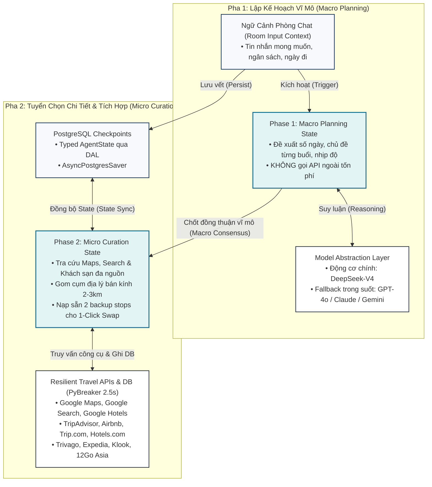
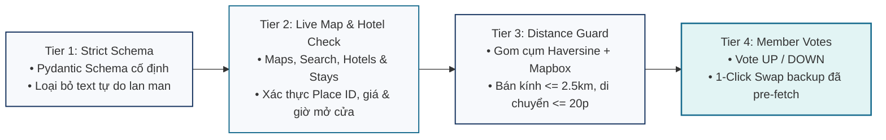
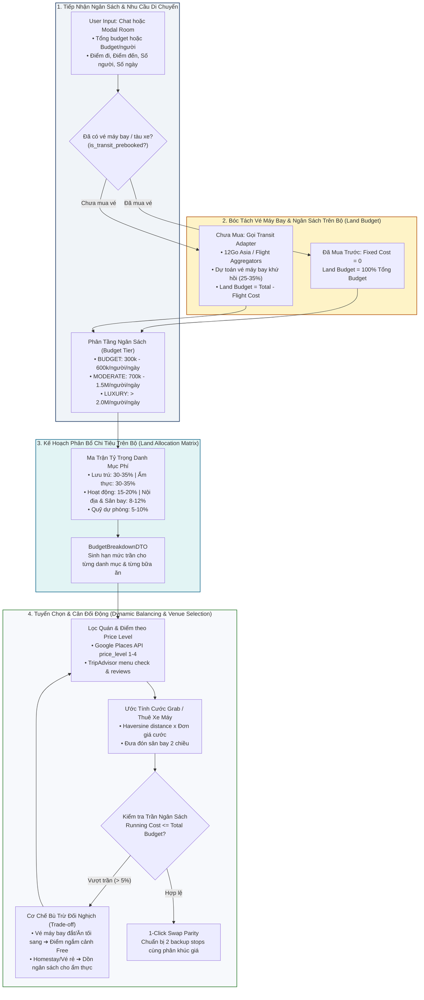

# 🤖 AI Agent Architecture: Unified DeepSeek-V4 & Four-Tier Grounding
## Dự án: TripMate AI — Intelligent Group Activity & Travel Planning Platform

> Tài liệu kỹ thuật chi tiết về kiến trúc **AI Agent hợp nhất (Unified AI Agent)**, mô hình suy luận **DeepSeek-V4**, máy trạng thái 2 pha trên **LangGraph Python**, tầng trừu tượng hóa mô hình (**Model Abstraction Layer**), và hàng rào 4 tầng chống ảo giác (**Four-Tier Grounding Pipeline**), bám sát 100% Mục 3, Hình 2 và Hình 3 trong Technical Proposal.

---

## 🧠 1. Kiến Trúc AI Agent Hợp Nhất (Unified AI Agent with Two-Phase State Execution)

Thay vì chia nhỏ thành nhiều sub-agent phân mảnh gây nghẽn độ trễ (latency bottleneck) và khó kiểm thử, TripMate AI ứng dụng **một Agent hợp nhất duy nhất chạy DeepSeek-V4 trên LangGraph Python**, hoạt động qua 2 pha trạng thái tách biệt:



### 1.1. Phase 1 — Macro Planning State (Trạng Thái Lập Kế Hoạch Vĩ Mô)
- **Mục tiêu**: Đề xuất ngày đi, nhịp độ và chủ đề cho từng buổi sáng/chiều/tối dựa trên mong muốn của nhóm.
- **Tiết kiệm Token & Chi phí**: Ở pha này, Agent **tuyệt đối không gọi các API du lịch bên ngoài** (Google Maps, khách sạn, Klook), bảo tồn token và giảm tối đa chi phí cho đến khi nhóm đạt được thỏa thuận vĩ mô.
- **Độ trễ**: Thời gian phản hồi nhanh ($6$--$12$\,giây).

### 1.2. Phase 2 — Micro Curation State (Trạng Thái Tuyển Chọn Địa Điểm Chi Tiết)
- **Kích hoạt**: Chỉ được kích hoạt **sau khi Host bấm nút Khóa Lộ Trình Vĩ Mô (Macro Consensus)**.
- **Nghiệp vụ**: Thực thi các lệnh gọi công cụ ngoài qua PyBreaker kết nối bộ Adapter đa nguồn (**Google Maps, Google Search, Google Hotels, TripAdvisor, Airbnb, Trip.com, Hotels.com, Trivago, Expedia**), áp dụng thuật toán gom cụm khoảng cách Haversine ($\le 2.5$\,km, thời gian di chuyển $\le 20$\,phút), và chuẩn bị sẵn 2 địa điểm dự phòng cho mỗi điểm dừng chính phục vụ cơ chế 1-Click Swap.
- **Độ trễ**: $10$--$20$\,giây (truy vấn song song các địa điểm thực tế).

---

## 🛡️ 2. Hàng Rào Chống Ảo Giác 4 Tầng (Four-Tier Grounding Pipeline)

Để đảm bảo **0% địa điểm ảo** và giải quyết triệt để vấn đề "bịa đặt thông tin" của mô hình ngôn ngữ lớn, TripMate AI bắt buộc mọi địa điểm xuất xưởng phải vượt qua 4 tầng rào chắn:



### Chi tiết 4 tầng bảo vệ:
1. **Tier 1 (Strict Schema)**: Ép đầu ra của LLM vào cấu trúc Pydantic nghiêm ngặt (`PlaceCandidate`), gồm các trường bắt buộc: `name`, `category`, `estimated_stay_minutes`, `budget_tier`, `lat_hint`, `lng_hint`. Bất kỳ đầu ra nào không khớp schema sẽ bị Pydantic v2 chặn lại và yêu cầu LLM format lại ngay lập tức.
2. **Tier 2 (Live Map & Hotel Check)**: Xác thực chéo từng địa điểm và khách sạn qua hệ sinh thái API đối tác:
   - **Bản đồ & Điểm tham quan**: Google Maps (Google Places API New), Google Search, TripAdvisor, OpenStreetMap.
   - **Khách sạn & Nơi lưu trú**: Google Hotels, Airbnb, Trip.com, Hotels.com, Trivago, Expedia.
   - Bắt buộc kiểm tra tọa độ GPS có thật, cờ `open_now`, giá phòng theo thời gian thực và đối chiếu giờ đóng/mở cửa với khung giờ dự kiến ghé thăm.
3. **Tier 3 (Distance Guard — Gom Cụm Thông Minh)**:
   - Sử dụng công thức khoảng cách Haversine:
     $$d = 2r \arcsin\left(\sqrt{\sin^2\left(\frac{\Delta \phi}{2}\right) + \cos(\phi_1)\cos(\phi_2)\sin^2\left(\frac{\Delta \lambda}{2}\right)}\right)$$
   - Kết hợp Mapbox Matrix API: Các điểm dừng trong cùng nửa ngày bắt buộc phải nằm trong bán kính **$2.0$--$2.5$\,km** và thời gian di chuyển **$\le 20$\,phút**. Loại bỏ hoàn toàn lộ trình ziczac qua lại giữa các quận xa nhau.
4. **Tier 4 (Member Votes & 1-Click Swap)**: Đặt quyền quyết định vào tay người dùng. Từng thành viên trong phòng vote UP/DOWN cho điểm dừng; điểm dừng bị từ chối lập tức được thay thế bằng 1 trong 2 địa điểm dự phòng đã được xác thực sẵn thông qua nút bấm **1-Click Swap** (thời gian đổi chỉ $3$--$6$\,giây).

---

## 🔄 3. Lớp Trừu Tượng Hóa Mô Hình (Model Abstraction Layer)

Để loại bỏ rủi ro phụ thuộc vào một nhà cung cấp duy nhất (Vendor Lock-in), toàn bộ logic gọi AI đều đi qua lớp trừu tượng hóa:

```python
class LLMModelAbstraction:
    """Lớp trừu tượng hóa mô hình ngôn ngữ lớn hỗ trợ fallback tự động."""
    
    PRIMARY_MODEL = "deepseek-v4"
    FALLBACK_MODELS = ["gpt-4o", "claude-3-5-sonnet", "gemini-1.5-pro"]
    
    async def generate_response(self, messages: list[dict], tools: list[dict] = None):
        try:
            # 1. Ưu tiên gọi DeepSeek-V4
            return await self._call_deepseek_v4(messages, tools)
        except (RateLimitException, APITimeoutException, ServiceUnavailableException) as exc:
            logger.warning(f"DeepSeek-V4 gặp sự cố ({exc}). Kích hoạt fallback...")
            # 2. Tự động chuyển luồng sang GPT-4o / Claude / Gemini
            return await self._call_fallback_llm(messages, tools)
```

---

## 💾 4. Quản Lý Trạng Thái & Checkpoint (Typed State Persistence)

Trạng thái của LangGraph được định nghĩa chặt chẽ bằng Pydantic `TypedDict` và lưu trữ bền bỉ trong schema `checkpoints` của Supabase PostgreSQL thông qua `AsyncPostgresSaver`:

```python
from typing import TypedDict, Optional, List
from pydantic import BaseModel

class PlaceStopDTO(BaseModel):
    place_name: str
    place_ref_id: str  # Google Place ID thật 100%
    category: str      # RESTAURANT | CAFE | ATTRACTION | HOTEL | ENTERTAINMENT
    lat: float
    lng: float
    duration_minutes: int
    price_level: int = 1       # Google Places Price Level: 0 (Free), 1 ($), 2 ($$), 3 ($$$), 4 ($$$$)
    estimated_cost: float      # Chi phí ước tính cho cả nhóm (VNĐ)
    cost_per_person: float     # Chi phí ước tính trên đầu người (VNĐ)
    backup_options: List[dict] # 2 địa điểm dự phòng cùng phân khúc giá cho 1-click swap

class TransitInfoDTO(BaseModel):
    is_prebooked: bool = False             # Đã tự mua vé chặng dài trước chưa (True: bỏ qua khỏi trần tối ưu)
    transit_mode: str = "FLIGHT"           # "FLIGHT" (Vé máy bay) | "TRAIN" (Tàu hỏa) | "INTERCITY_BUS" (Xe khách) | "NONE"
    carrier_hint: Optional[str] = None     # Vietjet Air, Vietnam Airlines, Bamboo Airways, 12Go Asia, VNR
    origin_city: Optional[str] = None      # Thành phố xuất phát (HAN, SGN...)
    destination_city: Optional[str] = None # Điểm đến (DAD, PQC, BKK...)
    roundtrip_cost_per_person: float = 0   # Giá vé khứ hồi ước tính / người (VNĐ)
    total_transit_cost: float = 0          # Tổng tiền vé máy bay/tàu toàn đoàn (VNĐ)

class BudgetBreakdownDTO(BaseModel):
    total_budget: float                    # Tổng ngân sách toàn bộ chuyến đi (VNĐ)
    is_transit_prebooked: bool = False     # True nếu nhóm đã có vé máy bay/tàu từ trước
    intercity_transit_budget: float        # Quỹ vé máy bay/tàu liên tỉnh khứ hồi (25-35% nếu chưa book)
    land_budget: float                     # Ngân sách chi tiêu trên bộ tại điểm đến (= total_budget - intercity_transit)
    accommodation_budget: float            # Quỹ lưu trú khách sạn/homestay (30-35% của land_budget)
    dining_budget: float                   # Quỹ ẩm thực sáng, trưa, tối, cafe (30-35% của land_budget)
    attraction_budget: float               # Quỹ vé tham quan, trải nghiệm Klook (15-20% của land_budget)
    local_transport_budget: float          # Quỹ đi lại nội thành & đưa đón sân bay (8-12% của land_budget)
    contingency_buffer: float              # Quỹ dự phòng trượt giá phát sinh (5-10% của land_budget)

class AgentState(TypedDict):
    event_id: str
    phase: str                  # "MACRO_PLANNING" | "MICRO_CURATION" | "FINALIZED"
    macro_locked: bool          # True khi Host đã bấm Consensus 1
    final_locked: bool          # True khi Host đã bấm Consensus 2
    scope: str                  # "DAY_HANGOUT" | "VACATION"
    group_size: int             # Số lượng thành viên trong đoàn
    budget_tier: str            # "BUDGET" | "MODERATE" | "LUXURY"
    transit_info: dict          # Dữ liệu vé máy bay / tàu xe liên tỉnh (TransitInfoDTO)
    budget_breakdown: dict      # Kế hoạch phân bổ chi tiêu chi tiết (BudgetBreakdownDTO)
    running_cost: float         # Tổng chi phí đã phân bổ các điểm dừng hiện tại
    daily_themes: List[dict]    # Khung chương trình vĩ mô từng ngày
    plan_stops: List[dict]      # Danh sách điểm dừng chi tiết đã qua 4-Tier Grounding
    user_desires: dict          # Ngân sách, khẩu vị, ngày đi, sở thích
    messages: List[dict]        # Lịch sử hội thoại trong phòng


```

### Cơ chế khôi phục phiên tự động (Fault Recovery):
- Mỗi khi người dùng chat hoặc vote, `AsyncPostgresSaver` ghi nhận checkpoint mới nhất gắn liền với `event_id`.
- Nếu container AI Worker trên Render bị restart hoặc đứt kết nối mạng giữa chừng, tiến trình worker mới chỉ cần đọc checkpoint từ PostgreSQL qua Data Access Layer (DAL) là có thể tiếp tục xử lý chính xác tác vụ mà không làm mất bất kỳ dữ liệu nào của phòng.

---

## 🏨 5. Tầng Bộ Chuyển Đổi Dịch Vụ Du Lịch & Khách Sạn (Travel Provider Adapter Pattern)

Để dễ dàng mở rộng và tích hợp đồng thời nhiều nhà cung cấp khách sạn và địa điểm (**Google Maps, Google Search, Google Hotels, TripAdvisor, Airbnb, Trip.com, Hotels.com, Trivago, Expedia**), hệ thống áp dụng **Adapter & Strategy Pattern** với lớp cơ sở trừu tượng:

```python
from abc import ABC, abstractmethod
from typing import List, Optional
from pydantic import BaseModel

class AccommodationItem(BaseModel):
    provider_name: str         # "google_hotels" | "airbnb" | "trip_com" | "hotels_com" | "trivago" | "expedia"
    name: str
    price_per_night: float
    currency: str = "VND"
    rating: float
    review_count: int
    lat: float
    lng: float
    booking_url: str
    amenities: List[str]

class TransitTicketItem(BaseModel):
    provider_name: str         # "12go_asia" | "flight_aggregator" | "vnr"
    transit_mode: str          # "FLIGHT" | "TRAIN" | "INTERCITY_BUS"
    carrier_name: str          # "Vietjet Air" | "Vietnam Airlines" | "Bamboo Airways" | "Phuong Trang"
    origin: str                # Mã sân bay/ga đi (HAN, SGN...)
    destination: str           # Mã sân bay/ga đến (DAD, PQC, BKK...)
    departure_time: str
    arrival_time: str
    price_per_person: float    # Giá vé 1 chiều / người (VNĐ)
    roundtrip_price: float     # Giá vé khứ hồi ước tính / người (VNĐ)
    currency: str = "VND"
    booking_url: str

class BaseTravelProvider(ABC):
    """Interface cơ sở cho mọi Travel, Transit & Lodging Adapter."""
    
    @abstractmethod
    async def search_accommodations(
        self, destination: str, checkin: str, checkout: str, guests: int, budget_tier: str
    ) -> List[AccommodationItem]:
        """Tìm kiếm nơi lưu trú theo các tiêu chí chuẩn hóa."""
        pass

    @abstractmethod
    async def search_pois(
        self, lat: float, lng: float, radius_km: float, category: str
    ) -> List[dict]:
        """Tìm kiếm điểm tham quan, ăn uống theo vị trí địa lý."""
        pass

    @abstractmethod
    async def search_intercity_transit(
        self, origin: str, destination: str, departure_date: str, return_date: str, guests: int, transit_mode: str
    ) -> List[TransitTicketItem]:
        """Tra cứu vé máy bay, tàu hỏa hoặc xe khách liên tỉnh khứ hồi."""
        pass
```

### Các lớp chuyển đổi cụ thể (Concrete Adapters):
1. **GoogleMapsProvider & GoogleHotelsProvider**: Xác thực Place ID, tọa độ chính xác và giá phòng niêm yết trên Google Travel.
2. **TripAdvisorProvider**: Lấy thông tin xếp hạng uy tín và đánh giá xác thực từ cộng đồng du lịch.
3. **AirbnbProvider**: Tìm kiếm căn hộ, homestay và villa theo nhóm đông người.
4. **TripComProvider, HotelsDotComProvider, TrivagoProvider, ExpediaProvider**: So sánh giá phòng theo thời gian thực và lấy link đặt phòng đối tác tốt nhất.
5. **TransitProvider (12Go Asia & Flight Aggregators)**: Tra cứu lịch trình và giá vé máy bay (Vietjet, Vietnam Airlines, Bamboo), tàu hỏa VNR và xe khách liên tỉnh chất lượng cao.


### Lợi ích thiết kế (Design Benefits):
- **Dễ Maintain**: Mỗi provider được cô lập trong 1 file riêng (`app/adapters/providers/<provider_name>.py`). Lỗi từ 1 API không làm sụp đổ các provider khác.
- **Dễ Dev (High DX)**: Developer mới chỉ cần kế thừa `BaseTravelProvider` và hiện thực 2 hàm trừu tượng để cắm thêm bất kỳ dịch vụ du lịch mới nào.
- **Dễ Hiểu**: Cấu trúc rõ ràng, interface chuẩn mực, kết hợp PyBreaker và Redis Caching trong suốt.

---

## 💰 6. Hệ Thống Lập Kế Hoạch & Cân Đối Chi Tiêu Thông Minh (Intelligent Budget & Price Balancing Engine)

Để giải quyết bài toán mâu thuẫn tài chính nan giải trong nhóm du lịch ("người muốn tiết kiệm, người thích sang chảnh", và gánh nặng chi phí vé máy bay/di chuyển liên tỉnh), AI Agent DeepSeek-V4 được trang bị động cơ **quản trị và cân đối ngân sách thông minh (Intelligent Budget Balancing Engine)** hoạt động xuyên suốt từ Pha 1 đến Pha 2:



---

### 6.1. Thu Thập & Mô Hình Hóa Tổng Ngân Sách (Total Budget & Group Modeling)

Hệ thống trích xuất thông tin tài chính từ tin nhắn phòng chat (Pha 1) hoặc thiết lập ban đầu của Host:
- **Trường dữ liệu cốt lõi**:
  - `total_budget` (VNĐ): Tổng ngân sách dự kiến của cả nhóm.
  - `group_size`: Số thành viên chính thức trong phòng.
  - `duration_days`: Thời gian diễn ra chuyến đi ($N$ ngày).
  - `is_transit_prebooked`: Cờ xác định nhóm đã tự mua vé máy bay/tàu xe từ trước hay chưa.
  - `transit_mode`: Loại hình phương tiện đường dài (`FLIGHT`, `TRAIN`, `INTERCITY_BUS`, `NONE`).

- **Công thức tính Ngân Sách Trên Bộ Thực Tế (Land Budget)**:
  $$\text{LandBudget} = \text{TotalBudget} - \text{IntercityTransitCost}$$
  - *Nếu đã tự mua vé (`is_transit_prebooked = True`)*: $\text{IntercityTransitCost} = 0 \implies \text{LandBudget} = \text{TotalBudget}$.
  - *Nếu chưa mua vé (`is_transit_prebooked = False`)*: AI truy vấn qua Transit Adapter (12Go Asia / Flight Aggregators) để dự toán chi phí vé khứ hồi cho đoàn, khóa riêng khoản này và chỉ phân bổ phần $\text{LandBudget}$ còn lại.

- **Công thức chuẩn hóa bình quân ngày/người trên bộ**:
  $$Budget_{\text{daily\_land\_per\_person}} = \frac{\text{LandBudget}}{\text{group\_size} \times \text{duration\_days}}$$

- **Bảng phân tầng ngân sách chuẩn (Budget Tiers Taxonomy)**:

| Phân khúc (`budget_tier`) | Ngân sách/người/ngày (VNĐ) | Chuyến 3N2Đ tiêu biểu/người | Phong cách trải nghiệm | Nơi lưu trú & Ẩm thực chủ đạo |
|---|:---:|:---:|---|---|
| **`BUDGET`** (Tiết kiệm) | $300.000$ -- $600.000$ | $1.200.000$ -- $2.000.000$ | Du lịch phượt, khám phá văn hóa bản địa, tối ưu chi phí | Homestay dorm, hostel, quán ăn bình dân đường phố, cafe vỉa hè |
| **`MODERATE`** (Tiêu chuẩn) | $700.000$ -- $1.500.000$ | $2.500.000$ -- $5.000.000$ | Thoải mái, cân bằng nghỉ ngơi và trải nghiệm, phổ biến nhất ($75\%$) | Khách sạn 3 sao, căn hộ Airbnb, quán ăn đặc sản nổi tiếng, cafe view đẹp |
| **`LUXURY`** (Cao cấp) | $> 2.000.000$ | $> 7.000.000$ | Nghỉ dưỡng cao cấp, thư giãn, ẩm thực tinh hoa | Resort 4-5 sao, villa riêng biệt, nhà hàng hải sản tươi sống, fine dining |

---

### 6.2. Kế Hoạch Chi Tiêu & Ma Trận Phân Bổ Danh Mục Phí (Spending Plan Allocation Matrix)

Để tránh tình trạng "vung tay quá trán" trong những ngày đầu dẫn đến thiếu hụt chi phí về sau, AI Agent chia nhỏ tổng ngân sách thành **2 tầng phí rõ rệt**:

#### Tầng 1: Chi phí Di chuyển Đường dài / Liên tỉnh (Intercity Transit)
- **Vé máy bay khứ hồi (Flights)**: Thường chiếm **$25$--$35\%$ tổng ngân sách** cho các chặng bay nội địa phổ biến (Hà Nội/Sài Gòn $\leftrightarrow$ Đà Nẵng, Phú Quốc, Nha Trang, Đà Lạt) hoặc Đông Nam Á (Bangkok, Singapore).
- **Vé tàu hỏa (VNR) / Xe khách Limousine (12Go Asia)**: Thường chiếm **$10$--$18\%$ tổng ngân sách** cho các chặng cự ly trung bình ($< 400$\,km: Sài Gòn $\leftrightarrow$ Vũng Tàu/Đà Lạt, Hà Nội $\leftrightarrow$ Sapa/Hạ Long).

#### Tầng 2: Chi phí Tại Điểm Đến (Land Budget Breakdown)
1. **`ACCOMMODATION` (Phí lưu trú)**: Tiền thuê khách sạn, homestay, villa (chia đều theo đêm).
2. **`DINING` (Phí ẩm thực)**: Ăn sáng, ăn trưa, ăn tối, cafe và thức uống thư giãn.
3. **`ATTRACTION` (Phí vé tham quan & Trải nghiệm)**: Vé vào cổng khu du lịch, cáp treo, vé bảo tàng, workshop, tour chèo SUP.
4. **`LOCAL_TRANSPORT` (Phí di chuyển nội thành & Sân bay)**: Xe đưa đón sân bay 2 chiều, thuê xe máy ($120.000$--$180.000$\,đ/xe/ngày), taxi / Grab giữa các cụm địa điểm.
5. **`CONTINGENCY` (Quỹ dự phòng phát sinh)**: Quỹ phòng ngừa rủi ro trượt giá, mua sắm lặt vặt, phụ phí dịch vụ ($5$--$10\%$).

#### Bảng ma trận tỷ trọng phân bổ khoa học:

| Hạng mục chi phí | Vacation — Chưa có vé máy bay/tàu | Vacation — Đã có vé máy bay trước (Land Only) | Day Hangout (Đi chơi trong ngày) | Cơ chế tính toán của AI Agent |
|---|:---:|:---:|:---:|---|
| ✈️ **Vé máy bay/Tàu xe chặng dài** | **$28$--$32\%$** *(Tổng)* | Đã thanh toán riêng ($0\%$) | $0\%$ | Báo giá thời gian thực từ 12Go Asia / Flight Aggregators |
| 🏨 **Lưu trú (Accommodation)** | **$22$--$25\%$** *(Tổng)* | **$30$--$35\%$** *(Land)* | $0\%$ | Giá niêm yết đêm $\times$ số phòng cần thuê qua Travel Adapters |
| 🍽️ **Ẩm thực (Dining & Cafes)** | **$22$--$25\%$** *(Tổng)* | **$30$--$35\%$** *(Land)* | **$50$--$55\%$** | Sáng ($10\%$), Trưa ($35\%$), Tối ($40\%$), Cafe ($15\%$) |
| 🎟️ **Hoạt động & Vé (Attractions)** | **$10$--$14\%$** *(Tổng)* | **$15$--$20\%$** *(Land)* | **$30$--$35\%$** | Bám sát giá vé cố định từ đối tác Klook / Google Places |
| 🚗 **Di chuyển nội thành & Sân bay** | **$6$--$8\%$** *(Tổng)* | **$8$--$12\%$** *(Land)* | **$10\%$** | Đưa đón sân bay + cước Grab/xe máy tính theo km Haversine |
| 🛡️ **Quỹ dự phòng (Contingency)** | **$5\%$** *(Tổng)* | **$5$--$10\%$** *(Land)* | **$5\%$** | Khóa cố định, không được phân bổ vào các điểm dừng cố định |

---

### 6.3. Cơ Chế AI Agent Nhận Biết & Cân Đối Chi Tiêu Động (Dynamic Budget Balancing & Trade-offs)

Khi thực thi ở Pha 2 (**Micro Curation State**), Agent liên tục giám sát và thực thi 4 nguyên lý cân đối:

#### 1. Nguyên lý Giám sát Cộng dồn Toàn diện (Total Running Cost Monitoring)
Agent duy trì biến trạng thái `running_cost` trong `AgentState`. Tại mỗi bước xếp điểm dừng, Agent kiểm tra điều kiện an toàn:
$$\text{running\_cost} = \text{IntercityTransitCost} + \text{AirportTransferCost} + \sum_{i=1}^{k} \text{estimated\_cost}(Stop_i) + \sum_{j=1}^{m} \text{TransitHopCost}_j \le \text{TotalBudget} \times (1 - \text{ContingencyRate})$$

#### 2. Tính Toán Chi Phí Di Chuyển Nội Thành Tự Động (Automated Local Transit Estimation)
Agent không để sót chi phí đi lại cục bộ tại điểm đến:
- **Đưa đón sân bay (Airport Transfer)**: Nếu đoàn bay đến sân bay (ví dụ sân bay Đà Nẵng về Hội An $\approx 30$\,km; sân bay Cam Ranh về Nha Trang $\approx 35$\,km), Agent tự động lập ngân sách đưa đón 2 chiều (xe 7 chỗ hoặc 16 chỗ hợp đồng, $\approx 300.000$ -- $500.000$\,đ/chuyến).
- **Di chuyển giữa các cụm điểm dừng (Inter-stop Hops)**: Với mỗi 2 điểm dừng liên tiếp có khoảng cách Haversine $d$, Agent tính cước di chuyển ước tính:
  $$\text{HopCost} = \begin{cases}
  \frac{\text{DailyBikeRental} \times \lceil group\_size / 2 \rceil}{StopsCount} & \text{nếu đoàn chọn thuê xe máy} \\
  \text{GrabBaseRate} + d \times \text{PerKmRate} & \text{nếu đoàn chọn GrabCar / Taxi}
  \end{cases}$$
- **Tối ưu quy mô nhóm (Group Size Multiplier)**: Nếu đoàn $\ge 4$ người, Agent tự động gợi ý đi chung xe GrabCar 7 chỗ hoặc thuê ô tô trọn gói có tài xế thay vì thuê nhiều xe máy lẻ, vừa an toàn vừa tiết kiệm $20\%$ chi phí đi lại.

#### 3. Cơ Chế Bù Trừ Đối Nghịch Thông Minh (Dynamic Trade-off Compensation)
Agent phản ứng linh hoạt trước các biến động giá thực tế:
- **Biến động giá vé máy bay**: Nếu nhóm đi vào mùa cao điểm du lịch khiến giá vé máy bay tăng thêm $30\%$, Agent chủ động đề xuất: *"Giá vé máy bay đang ở mức cao (1.800.000 đ/người khứ hồi). Agent đã tự động điều chỉnh phân khúc khách sạn từ 4 sao sang 3 sao tiện nghi và tăng cường các điểm tham quan bãi biển/phố cổ miễn phí để đảm bảo tổng chi phí không vượt ngân sách!"*
- **Bữa ăn sang chảnh (Fine Dining Trade-off)**: Khi người dùng yêu cầu bữa tối hải sản cao cấp vượt hạn mức bữa ăn ($\Delta_{\text{excess}}$), Agent cân đối bằng cách chuyển điểm tham quan buổi chiều sang **địa điểm miễn phí vé** (Cầu Rồng, Bán đảo Sơn Trà, Bãi biển Mỹ Khê) và chọn quán cafe bình dân view đẹp.
- **Tiết kiệm nơi ở/vé máy bay rẻ**: Nếu săn được vé máy bay 0đ hoặc ở homestay giá tốt, Agent thực hiện tái phân bổ thặng dư (`slack_redistribution`) sang nâng cấp bữa tiệc BBQ hải sản đêm hoặc mua vé tham quan Sun World / Bà Nà Hills.

#### 4. Cảnh Báo Bội Chi Chủ Động (Proactive Over-budget Warning)
Nếu tổng chi phí các điểm dừng được chọn vượt quá trần cho phép ($> 105\%$ tổng budget), Agent không âm thầm chấp nhận mà đưa ra gợi ý điều chỉnh cụ thể vào luồng chat phòng kèm phương án 1-Click Swap xuống quán tương đương thuộc phân khúc thấp hơn.

---

### 6.4. Cơ Chế Tuyển Chọn Quán Ăn & Địa Điểm Theo Mức Giá (Venue Selection by Price Level)

Để đảm bảo giá tiền quán ăn đề xuất khớp tuyệt đối với túi tiền của nhóm, Agent kết hợp mã phân hạng giá từ **Google Places API New** và thông tin kiểm chứng thực tế:

#### Bản đồ ánh xạ phân khúc giá (Price Level Mapping):

| Google Places `price_level` | Biểu tượng | Khoảng giá ước tính / người / bữa | Loại hình quán & Trải nghiệm thực tế | Ví dụ tiêu biểu (Việt Nam) |
|:---:|:---:|:---:|---|---|
| **0** | `Free` | $0$\,VNĐ | Điểm công cộng, công viên, quảng trường, bãi biển | Cầu Sông Hàn, Phố đi bộ, Hồ Gươm |
| **1** | `$` *(Inexpensive)* | $30.000$ -- $80.000$\,VNĐ | Quán ăn đường phố, đặc sản bình dân, tiệm bánh mì, cafe cóc | Bún bò gánh, Cơm tấm, Bánh xèo bà Dưỡng, Cafe vợt |
| **2** | `$$` *(Moderate)* | $90.000$ -- $250.000$\,VNĐ | Nhà hàng gia đình, quán nướng/lẩu phổ thông, chuỗi cafe máy lạnh | Cơm niêu, Quán nướng ngói, The Coffee House, Phê La |
| **3** | `$$$` *(Expensive)* | $260.000$ -- $600.000$\,VNĐ | Nhà hàng hải sản lớn, ẩm thực Nhật/Hàn cao cấp, rooftop bar view đẹp | Nhà hàng Cua Đỏ, Kichi Kichi / Manwah, Sky Lounge |
| **4** | `$$$$` *(Very Expensive)* | $> 600.000$\,VNĐ | Fine Dining sang trọng, Tasting menu, Buffet khách sạn 5 sao | Anan Saigon, La Maison 1888, InterContinental Buffet |

#### Quy trình 3 bước tuyển chọn quán ăn của Agent:

1. **Bước 1 — Lọc theo hạn mức bữa ăn (Budget-bounded Query)**:
   - Từ phân bổ ngân sách cho bữa ăn cụ thể (ví dụ: Bữa trưa Ngày 1 được cấp tối đa $120.000$\,đ/người), Agent truy vấn Adapter với bộ lọc `price_levels = [1, 2]`.
2. **Bước 2 — Xác thực thực tế qua Grounding (Menu & Review Extraction)**:
   - Trích xuất dữ liệu thẻ giá thực tế từ Google Search snippets và bài đánh giá TripAdvisor để xác nhận mức chi tiêu trung bình thực tế tại quán, loại trừ các quán tuy gắn mác bình dân nhưng có hiện tượng chặt chém khách du lịch.
3. **Bước 3 — Nạp 2 phương án dự phòng đồng giá (Backup Parity for 1-Click Swap)**:
   - Với mỗi quán ăn chính được chọn, Agent luôn tìm kiếm thêm **2 quán ăn thay thế nằm trong bán kính $\le 1$\,km và có cùng phân khúc giá (Price Parity)**.
   - Khi thành viên trong nhóm không thích món ăn đó và bấm **1-Click Swap**, địa điểm mới thay thế ngay lập tức mà **hoàn toàn không làm xáo trộn ngân sách chung** của cả chuyến đi.


