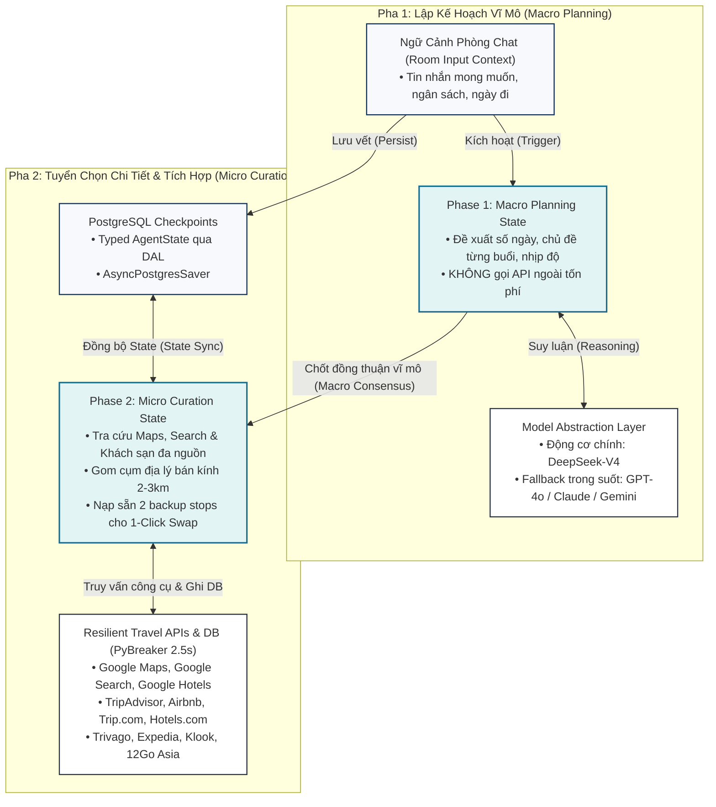
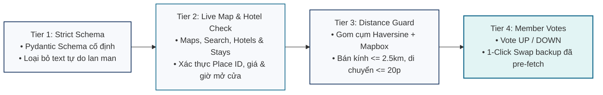

# 🤖 AI Agent Architecture: Unified DeepSeek-V4 & Four-Tier Grounding
## Dự án: TripMate AI — Intelligent Group Activity & Travel Planning Platform

> Tài liệu kỹ thuật chi tiết về kiến trúc **AI Agent hợp nhất (Unified AI Agent)**, mô hình suy luận **DeepSeek-V4**, máy trạng thái 2 pha trên **LangGraph Python**, tầng trừu tượng hóa mô hình (**Model Abstraction Layer**), và hàng rào 4 tầng chống ảo giác (**Four-Tier Grounding Pipeline**), bám sát 100% Mục 3, Hình 2 và Hình 3 trong Technical Proposal.

---

## 🧠 1. Kiến Trúc AI Agent Hợp Nhất (Unified AI Agent with Two-Phase State Execution)

Thay vì chia nhỏ thành nhiều sub-agent phân mảnh gây nghẽn độ trễ (latency bottleneck) và khó kiểm thử, TripMate AI ứng dụng **một Agent hợp nhất duy nhất chạy DeepSeek-V4 trên LangGraph Python**, hoạt động qua 2 pha trạng thái tách biệt:



### 1.1. Phase 1 — Macro Planning State (Trạng Thái Lập Kế Hoạch Vĩ Mô)
- **Mục tiêu**: Đề xuất ngày đi, nhịp độ và chủ đề cho từng buổi sáng/chiều/tối dựa trên mong muốn của nhóm.
- **Tiết kiệm Token & Chi phí**: Ở pha này, Agent **tuyệt đối không gọi các API du lịch bên ngoài** (Google Maps, khách sạn, Klook), bảo tồn token và giảm tối đa chi phí cho đến khi nhóm đạt được thỏa thuận vĩ mô.
- **Độ trễ**: Thời gian phản hồi nhanh ($6$--$12$\,giây).

### 1.2. Phase 2 — Micro Curation State (Trạng Thái Tuyển Chọn Địa Điểm Chi Tiết)
- **Kích hoạt**: Chỉ được kích hoạt **sau khi Host bấm nút Khóa Lộ Trình Vĩ Mô (Macro Consensus)**.
- **Nghiệp vụ**: Thực thi các lệnh gọi công cụ ngoài qua PyBreaker kết nối bộ Adapter đa nguồn (**Google Maps, Google Search, Google Hotels, TripAdvisor, Airbnb, Trip.com, Hotels.com, Trivago, Expedia**), áp dụng thuật toán gom cụm khoảng cách Haversine ($\le 2.5$\,km, thời gian di chuyển $\le 20$\,phút), và chuẩn bị sẵn 2 địa điểm dự phòng cho mỗi điểm dừng chính phục vụ cơ chế 1-Click Swap.
- **Độ trễ**: $10$--$20$\,giây (truy vấn song song các địa điểm thực tế).

---

## 🛡️ 2. Hàng Rào Chống Ảo Giác 4 Tầng (Four-Tier Grounding Pipeline)

Để đảm bảo **0% địa điểm ảo** và giải quyết triệt để vấn đề "bịa đặt thông tin" của mô hình ngôn ngữ lớn, TripMate AI bắt buộc mọi địa điểm xuất xưởng phải vượt qua 4 tầng rào chắn:



### Chi tiết 4 tầng bảo vệ:
1. **Tier 1 (Strict Schema)**: Ép đầu ra của LLM vào cấu trúc Pydantic nghiêm ngặt (`PlaceCandidate`), gồm các trường bắt buộc: `name`, `category`, `estimated_stay_minutes`, `budget_tier`, `lat_hint`, `lng_hint`. Bất kỳ đầu ra nào không khớp schema sẽ bị Pydantic v2 chặn lại và yêu cầu LLM format lại ngay lập tức.
2. **Tier 2 (Live Map & Hotel Check)**: Xác thực chéo từng địa điểm và khách sạn qua hệ sinh thái API đối tác:
   - **Bản đồ & Điểm tham quan**: Google Maps (Google Places API New), Google Search, TripAdvisor, OpenStreetMap.
   - **Khách sạn & Nơi lưu trú**: Google Hotels, Airbnb, Trip.com, Hotels.com, Trivago, Expedia.
   - Bắt buộc kiểm tra tọa độ GPS có thật, cờ `open_now`, giá phòng theo thời gian thực và đối chiếu giờ đóng/mở cửa với khung giờ dự kiến ghé thăm.
3. **Tier 3 (Distance Guard — Gom Cụm Thông Minh)**:
   - Sử dụng công thức khoảng cách Haversine:
     $$d = 2r \arcsin\left(\sqrt{\sin^2\left(\frac{\Delta \phi}{2}\right) + \cos(\phi_1)\cos(\phi_2)\sin^2\left(\frac{\Delta \lambda}{2}\right)}\right)$$
   - Kết hợp Mapbox Matrix API: Các điểm dừng trong cùng nửa ngày bắt buộc phải nằm trong bán kính **$2.0$--$2.5$\,km** và thời gian di chuyển **$\le 20$\,phút**. Loại bỏ hoàn toàn lộ trình ziczac qua lại giữa các quận xa nhau.
4. **Tier 4 (Member Votes & 1-Click Swap)**: Đặt quyền quyết định vào tay người dùng. Từng thành viên trong phòng vote UP/DOWN cho điểm dừng; điểm dừng bị từ chối lập tức được thay thế bằng 1 trong 2 địa điểm dự phòng đã được xác thực sẵn thông qua nút bấm **1-Click Swap** (thời gian đổi chỉ $3$--$6$\,giây).

---

## 🔄 3. Lớp Trừu Tượng Hóa Mô Hình (Model Abstraction Layer)

Để loại bỏ rủi ro phụ thuộc vào một nhà cung cấp duy nhất (Vendor Lock-in), toàn bộ logic gọi AI đều đi qua lớp trừu tượng hóa:

```python
class LLMModelAbstraction:
    """Lớp trừu tượng hóa mô hình ngôn ngữ lớn hỗ trợ fallback tự động."""
    
    PRIMARY_MODEL = "deepseek-v4"
    FALLBACK_MODELS = ["gpt-4o", "claude-3-5-sonnet", "gemini-1.5-pro"]
    
    async def generate_response(self, messages: list[dict], tools: list[dict] = None):
        try:
            # 1. Ưu tiên gọi DeepSeek-V4
            return await self._call_deepseek_v4(messages, tools)
        except (RateLimitException, APITimeoutException, ServiceUnavailableException) as exc:
            logger.warning(f"DeepSeek-V4 gặp sự cố ({exc}). Kích hoạt fallback...")
            # 2. Tự động chuyển luồng sang GPT-4o / Claude / Gemini
            return await self._call_fallback_llm(messages, tools)
```

---

## 💾 4. Quản Lý Trạng Thái & Checkpoint (Typed State Persistence)

Trạng thái của LangGraph được định nghĩa chặt chẽ bằng Pydantic `TypedDict` và lưu trữ bền bỉ trong schema `checkpoints` của Supabase PostgreSQL thông qua `AsyncPostgresSaver`:

```python
from typing import TypedDict, Optional, List
from pydantic import BaseModel

class PlaceStopDTO(BaseModel):
    place_name: str
    place_ref_id: str  # Google Place ID thật 100%
    category: str      # RESTAURANT | CAFE | ATTRACTION | HOTEL | ENTERTAINMENT
    lat: float
    lng: float
    duration_minutes: int
    estimated_cost: float
    backup_options: List[dict]  # 2 địa điểm dự phòng cho 1-click swap

class AgentState(TypedDict):
    event_id: str
    phase: str                  # "MACRO_PLANNING" | "MICRO_CURATION" | "FINALIZED"
    macro_locked: bool          # True khi Host đã bấm Consensus 1
    final_locked: bool          # True khi Host đã bấm Consensus 2
    daily_themes: List[dict]    # Khung chương trình vĩ mô từng ngày
    plan_stops: List[dict]      # Danh sách điểm dừng chi tiết đã qua 4-Tier Grounding
    user_desires: dict          # Ngân sách, khẩu vị, ngày đi
    messages: List[dict]        # Lịch sử hội thoại trong phòng
```

### Cơ chế khôi phục phiên tự động (Fault Recovery):
- Mỗi khi người dùng chat hoặc vote, `AsyncPostgresSaver` ghi nhận checkpoint mới nhất gắn liền với `event_id`.
- Nếu container AI Worker trên Render bị restart hoặc đứt kết nối mạng giữa chừng, tiến trình worker mới chỉ cần đọc checkpoint từ PostgreSQL qua Data Access Layer (DAL) là có thể tiếp tục xử lý chính xác tác vụ mà không làm mất bất kỳ dữ liệu nào của phòng.

---

## 🏨 5. Tầng Bộ Chuyển Đổi Dịch Vụ Du Lịch & Khách Sạn (Travel Provider Adapter Pattern)

Để dễ dàng mở rộng và tích hợp đồng thời nhiều nhà cung cấp khách sạn và địa điểm (**Google Maps, Google Search, Google Hotels, TripAdvisor, Airbnb, Trip.com, Hotels.com, Trivago, Expedia**), hệ thống áp dụng **Adapter & Strategy Pattern** với lớp cơ sở trừu tượng:

```python
from abc import ABC, abstractmethod
from typing import List, Optional
from pydantic import BaseModel

class AccommodationItem(BaseModel):
    provider_name: str         # "google_hotels" | "airbnb" | "trip_com" | "hotels_com" | "trivago" | "expedia"
    name: str
    price_per_night: float
    currency: str = "VND"
    rating: float
    review_count: int
    lat: float
    lng: float
    booking_url: str
    amenities: List[str]

class BaseTravelProvider(ABC):
    """Interface cơ sở cho mọi Travel & Lodging Adapter."""
    
    @abstractmethod
    async def search_accommodations(
        self, destination: str, checkin: str, checkout: str, guests: int, budget_tier: str
    ) -> List[AccommodationItem]:
        """Tìm kiếm nơi lưu trú theo các tiêu chí chuẩn hóa."""
        pass

    @abstractmethod
    async def search_pois(
        self, lat: float, lng: float, radius_km: float, category: str
    ) -> List[dict]:
        """Tìm kiếm điểm tham quan, ăn uống theo vị trí địa lý."""
        pass
```

### Các lớp chuyển đổi cụ thể (Concrete Adapters):
1. **GoogleMapsProvider & GoogleHotelsProvider**: Xác thực Place ID, tọa độ chính xác và giá phòng niêm yết trên Google Travel.
2. **TripAdvisorProvider**: Lấy thông tin xếp hạng uy tín và đánh giá xác thực từ cộng đồng du lịch.
3. **AirbnbProvider**: Tìm kiếm căn hộ, homestay và villa theo nhóm đông người.
4. **TripComProvider, HotelsDotComProvider, TrivagoProvider, ExpediaProvider**: So sánh giá phòng theo thời gian thực và lấy link đặt phòng đối tác tốt nhất.

### Lợi ích thiết kế (Design Benefits):
- **Dễ Maintain**: Mỗi provider được cô lập trong 1 file riêng (`app/adapters/providers/<provider_name>.py`). Lỗi từ 1 API không làm sụp đổ các provider khác.
- **Dễ Dev (High DX)**: Developer mới chỉ cần kế thừa `BaseTravelProvider` và hiện thực 2 hàm trừu tượng để cắm thêm bất kỳ dịch vụ du lịch mới nào.
- **Dễ Hiểu**: Cấu trúc rõ ràng, interface chuẩn mực, kết hợp PyBreaker và Redis Caching trong suốt.
