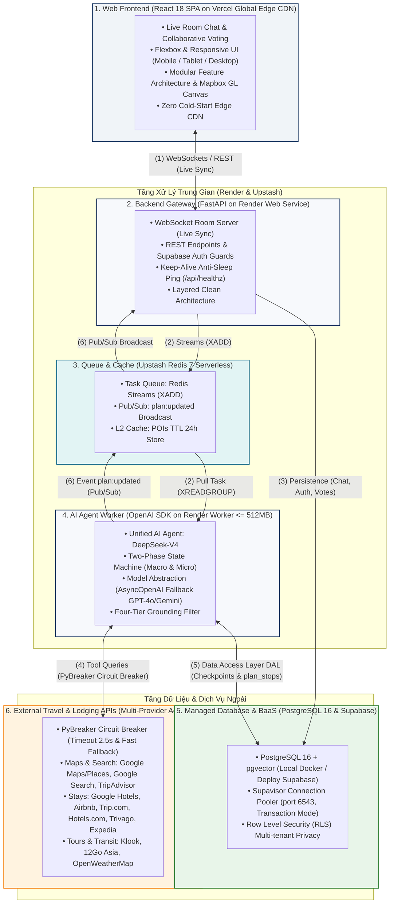
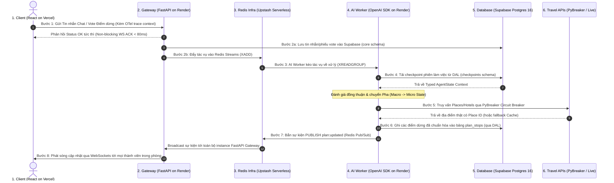

# 🏗️ System Architecture & Cloud Engineering
## Dự án: TripMate AI — Intelligent Group Activity & Travel Planning Platform

> Tài liệu chuẩn hóa kiến trúc tổng thể, các phân tầng thành phần, nền tảng triển khai đám mây, 6 giao diện kết nối (Interfaces 1--6) và luồng thực thi 8 bước của hệ thống TripMate AI, bám sát 100% Hình 4, Hình 5 và Bảng 2 trong Technical Proposal.

---

## ☁️ 1. Sơ Đồ Kiến Trúc Hệ Thống Tổng Thể (System Architecture & Interfaces)

Hệ thống TripMate AI áp dụng mô hình kiến trúc phi tập trung, bất đồng bộ và kháng lỗi cao, kết nối 6 phân tầng thành phần chính phân bổ trên các nền tảng điện toán đám mây:

---

## 🔌 2. Chi Tiết 6 Giao Diện Kết Nối Hệ Thống (Interfaces 1--6)

| Giao diện | Thành phần kết nối | Giao thức / Phương thức | Mục đích & Nghiệp vụ |
|:---:|---|:---:|---|
| **(1)** | **Frontend $\leftrightarrow$ Backend Gateway** | **WebSockets (`WSS`) / HTTPS REST** | Truyền tin nhắn phòng chat, gửi phiếu bình chọn điểm dừng (Vote UP/DOWN), gửi lệnh luân chuyển đa phương án (Multi-Option Swap: đổi sang Phương án 2, Phương án 3 hoặc yêu cầu AI nạp thêm), và nhận luồng đồng bộ tức thì (<80ms ACK). |
| **(2)** | **Gateway $\rightarrow$ Redis $\rightarrow$ AI Worker** | **Redis Streams (`XADD` / `XREADGROUP`)** | Hàng đợi tác vụ bất đồng bộ. Gateway đẩy task vào Redis Streams không chặn người dùng; AI Agent Worker (OpenAI SDK) kéo task về thực thi. |
| **(3)** | **Gateway $\rightarrow$ Supabase Database** | **SQLAlchemy Async / PostgreSQL (core schema)** | Lưu vết tức thì lịch sử tin nhắn phòng chat, thông tin người dùng, quyền hạn thành viên và số lượt bình chọn. |
| **(4)** | **AI Worker $\leftrightarrow$ External Travel & Lodging APIs** | **HTTPX Async qua PyBreaker Circuit Breaker & Adapter Pattern** | Truy vấn địa điểm và khách sạn thực tế từ Google Maps/Places, Google Search, Google Hotels, TripAdvisor, Airbnb, Trip.com, Hotels.com, Trivago, Expedia, Klook với cơ chế ngắt mạch tự động (timeout 2.5s). |
| **(5)** | **AI Worker $\leftrightarrow$ Supabase Database** | **Data Access Layer (DAL) / SQLAlchemy Async JSONB** | Nạp và lưu vết snapshot `AgentState` vào bảng `checkpoints.agent_checkpoints`; ghi các điểm dừng đã chuẩn hóa vào bảng `plan_stops`. |
| **(6)** | **AI Worker $\rightarrow$ Redis $\rightarrow$ Gateway** | **Redis Pub/Sub (`plan:updated`)** | Phát sóng sự kiện cập nhật lịch trình từ AI Worker tới mọi instance Gateway để chuyển tiếp xuống Frontend qua WebSockets. |

---

## ⚡ 3. Chu Trình Vận Hành End-to-End (8 Bước Thực Thi)

Quy trình thực thi tuần tự của hệ thống từ khi người dùng tương tác đến khi nhận được kết quả cập nhật:

### Bảng tóm tắt các bước theo Proposal:

| Bước | Giao diện | Chế độ | Phụ thuộc | Chức năng vận hành chi tiết |
|:---:|---|:---:|---|---|
| **1** | **(1)** Frontend $\rightarrow$ Gateway | Sync | Thao tác người dùng | Truyền tin nhắn chat hoặc vote điểm dừng kèm OpenTelemetry trace context. |
| **2a** | **(3)** Gateway $\rightarrow$ Database | Sync | Bước 1 | Lưu vết tin nhắn phòng và số phiếu vote vào Supabase (`core` schema). |
| **2b** | **(2)** Gateway $\rightarrow$ Redis (Streams) | Async | Bước 1 | Đẩy tác vụ bất đồng bộ vào Redis Streams (`XADD`); trả về HTTP/WS ACK ngay lập tức. |
| **3** | **(2)** Redis (Streams) $\rightarrow$ AI Agent | Async | Bước 2b | AI Agent Worker (OpenAI SDK) kéo tác vụ về xử lý qua Consumer Group (`XREADGROUP`). |
| **4** | **(5)** AI Agent $\leftarrow$ Database | Async | Bước 3 | Tải checkpoint phiên làm việc và ngữ cảnh phòng từ schema `checkpoints` qua DAL. |
| **4b** | Agent State Transition | Internal | Bước 4 | Đánh giá điều kiện đồng thuận và chuyển đổi giữa Macro State và Micro State. |
| **5** | **(4)** AI Agent $\leftrightarrow$ Travel APIs | Parallel | Bước 4b | Gọi hệ thống API đối tác (Google Maps, Google Search, Google Hotels, TripAdvisor, Airbnb, Trip.com, Hotels.com, Trivago, Expedia) qua PyBreaker; tự động lấy từ L2 Cache nếu API ngoài lỗi. |
| **6** | **(5)** AI Agent $\rightarrow$ Database | Async | Bước 5 | Ghi các điểm dừng đã kiểm chứng và chuẩn hóa vào bảng `plan_stops` qua DAL. |
| **7** | **(6)** AI Agent $\rightarrow$ Redis $\rightarrow$ Gateway | Async | Bước 6 | Bắn sự kiện `PUBLISH plan:updated` qua Redis Pub/Sub để đồng bộ các node Gateway. |
| **8** | **(1)** Gateway $\rightarrow$ Frontend | Push | Bước 7 | Phát sóng lộ trình mới nhất qua WebSockets tới tất cả thành viên trong phòng. |

---

## 🚦 3.1. Phân Định Luồng Chat Nhóm & Bộ Lọc Kích Hoạt AI Agent (Input Filter Layer)

Hệ thống giải quyết câu hỏi: *"Lúc nào chat thường, lúc nào thì gọi Agent bắt đầu làm việc?"* thông qua tầng kiểm soát tại FastAPI Gateway:

1. **Kênh Chat Nhóm Chung (Group Channel)**:
   - Toàn bộ thành viên trong phòng cùng tham gia vào 1 kênh chat thời gian thực qua WebSocket (`/ws/rooms/{roomId}`).
   - Các tin nhắn trao đổi, thảo luận thông thường (`'CHAT'`) được lưu vào CSDL và broadcast tới toàn bộ client trong phòng (<80ms) mà **tuyệt đối không kích hoạt AI Agent Worker**.
2. **Bộ Lọc Đầu Vào Cốt Lõi (Input Filter Layer)**:
   - Khi có tin nhắn gọi Agent (`@TripMate`) hoặc thao tác bấm nút tạo/sửa lịch trình, Gateway thực hiện 2 cấp lọc:
     - **Cấp 1 - Lọc rác (Noise Filter)**: Loại bỏ các câu chém gió không liên quan đến du lịch.
     - **Cấp 2 - Ép buộc tham số cốt lõi (Core Parameter Enforcement)**: Bắt buộc phải có **Location (Điểm đến)** và **Date (Thời gian/Ngày đi)**.
   - Nếu đủ tham số cốt lõi: Gateway mới đẩy tác vụ vào Redis Streams (`XADD`) để kích hoạt AI Worker.
   - Nếu thiếu tham số cốt lõi: Gateway phản hồi yêu cầu người dùng bổ sung thông tin, ngăn chặn hoàn toàn việc gọi LLM bừa bãi gây tốn token và sai lệch dữ liệu.
3. **Phân Luồng Tương Tác Của Agent**:
   - **Nhánh Hỏi Đáp / Gợi Ý Món Ăn (Q&A & Dish Suggestions)**: Tra cứu nhanh đặc sản, giải đáp thắc mắc du lịch, gợi ý món ăn theo sở thích ăn uống của thành viên $\rightarrow$ Trả lời trực tiếp dạng tin nhắn trong group chat, **không chạm vào Plan**.
   - **Nhánh Lập / Điều Chỉnh Lịch Trình (Planning Engine)**: Chạy qua Two-Phase State Machine (OpenAI SDK) $\rightarrow$ Ghi các `plan_stops` vào CSDL theo kịch bản 4 giai đoạn không ghi đè $\rightarrow$ Broadcast cập nhật lộ trình.

---

## 🌧️ 4. Minh Họa Kịch Bản: Lịch Trình Tự Động Thích Ứng Khi Trời Mưa (Dynamic On-The-Go Adaptation)

Để chứng minh sức mạnh của kiến trúc phân tầng bất đồng bộ, hãy xem xét kịch bản nhóm đang đi chơi thì gặp mưa to bất chợt:

1. **Người dùng nhắn tin**: Một thành viên nhắn vào chat: *"Trời đang mưa to quá, tìm giúp quán cafe trong nhà gần đây"*.
2. **Gateway phản hồi tức thì**: FastAPI Gateway nhận tin qua WebSocket, trả về ACK `< 80$\,ms, ghi tin nhắn vào bảng `chat_messages` (Supabase `core` schema, Bước 2a) và đẩy task vào Redis Streams (Bước 2b).
3. **AI Worker xử lý ngầm**: AI Agent Worker (OpenAI SDK) kéo task về (Bước 3), khôi phục phiên làm việc từ `checkpoints` schema (Bước 4), chuyển thẳng vào **Phase 2 Micro Curation State** (Bước 4b).
4. **Truy vấn địa điểm trong nhà**: AI gọi Google Places API tìm các quán cafe có tiện ích trong nhà nằm trong bán kính $\le 1.5$\,km qua PyBreaker (Bước 5).
5. **Cập nhật nguyên tử không ghi đè (Non-destructive History)**: Thay vì ghi đè làm mất dấu dữ liệu quá khứ, AI Agent thực hiện cơ chế lưu vết lịch sử:
   - Điểm dừng ngoài trời cũ được cập nhật trạng thái `stop_status = 'SKIPPED_ON_TRIP'` kèm lý do `change_reason = 'Trời mưa lớn tại địa điểm ngoài trời'`.
   - Điểm dừng trong nhà mới được chèn với `stop_status = 'ADAPTED_ON_TRIP'`, trỏ `replaced_by_stop_id` tới điểm cũ.
   - Toàn bộ các điểm dừng của các ngày khác được giữ nguyên 100%. Nhóm dễ dàng truy xuất cả 3 mốc: Ban đầu do AI gợi ý, Đã chốt sau khi vote, và Thực tế phát sinh lúc đang đi.
6. **Đồng bộ thời gian thực**: AI Worker bắn sự kiện `plan:updated` qua Redis Pub/Sub (Bước 7), FastAPI Gateway nhận sự kiện và phát sóng ngay lập tức tới điện thoại của tất cả các thành viên qua WebSockets (Bước 8). Bản đồ Mapbox trên máy người dùng tự động vẽ lại lộ trình mới!

---

## 🛡️ 5. Độ Bền Vận Hành & Khả Năng Mở Rộng Hành Tinh (Planet-Scale Readiness)

- **Vercel Edge CDN**: Phân phối tài nguyên tĩnh và giao diện React 18 trên hơn 300 điểm PoP toàn cầu, thời gian nạp trang $< 100$\,ms, zero cold-start.
- **Render Stateless Workers**: Cả FastAPI Gateway và AI Agent Worker (OpenAI SDK) đều là tiến trình phi trạng thái (stateless), có thể scale ngang (horizontal scaling) thêm instance bất cứ lúc nào.
- **Supavisor Connection Pooling**: Cụm pooler hoạt động ở port 6543 (Transaction Mode) giúp xử lý an toàn hơn 200 phiên client đồng thời chỉ với 15 kết nối vật lý tới PostgreSQL, ngăn ngừa lỗi `connection limit exceeded`.
- **PyBreaker Resilience**: Đảm bảo lỗi từ phía các API du lịch bên ngoài không bao giờ làm treo hay crash hệ thống backend của dự án.

---

## 🏛️ 6. Chuẩn Mực Thiết Kế Ứng Dụng: Architecture Patterns, Modular Design & Tiêu Chí Kỹ Thuật

TripMate AI được kiến tạo nhằm đáp ứng tối đa các tiêu chuẩn kỹ thuật chuyên nghiệp, đảm bảo ba giá trị cốt lõi: **Dễ Maintain, Dễ Dev, Dễ Hiểu**.

### 6.1. Architecture Pattern Phân Tầng Chuẩn Mực (Layered Clean Architecture)
Hệ thống tuân thủ chặt chẽ nguyên lý phân tầng và đảo ngược phụ thuộc (Dependency Inversion):
1. **Presentation / Transport Layer (FastAPI Routers)**: Tiếp nhận HTTP/WebSocket request, xác thực JWT, validate input bằng Pydantic Schema, chuyển tiếp tới Domain Service. Tuyệt đối không chứa logic nghiệp vụ hay truy vấn SQL trực tiếp.
2. **Domain / Business Service Layer**: Chứa toàn bộ nghiệp vụ cốt lõi: Two-Stage Consensus Engine, Geo-clustering logic, Itinerary validation, Venue dish recommendation, Budget estimation. Không phụ thuộc vào thư viện bên ngoài hay cơ sở dữ liệu cụ thể.
3. **Data Access Layer (DAL / Repository)**: Thực thi truy vấn dữ liệu bất đồng bộ qua SQLAlchemy 2.0 Async, trừu tượng hóa các bảng Supabase PostgreSQL.
4. **External Provider Adapter Layer (Strategy Pattern)**: Toàn bộ tương tác với các bên thứ 3 (**Google Maps, Google Search, Google Hotels, TripAdvisor, Airbnb, Trip.com, Hotels.com, Trivago, Expedia**) đều đi qua interface trừu tượng `BaseTravelProvider`. Tầng nghiệp vụ chỉ tương tác với interface này.

### 6.2. Thiết Kế Mô-Đun Hóa (Modular Design)
- **Feature-Driven Packaging**: Cả Frontend (`features/event-planning`, `features/ai-chat`) và Backend (`app/features/`, `app/adapters/`) đều được cấu trúc theo miền nghiệp vụ, cô lập hoàn toàn phạm vi thay đổi.
- **High Cohesion & Low Coupling**: Mỗi module đảm nhiệm một chức năng trọn vẹn. Các module giao tiếp với nhau bằng Contract tường minh (Pydantic DTOs & TypeScript Interfaces), nghiêm cấm Circular Dependencies.

### 6.3. Chuẩn Giao Diện: Flexbox & Fully Responsive UI
- **Flexbox & Grid Layouts**: 100% bố cục trang tuân theo `display: flex` và CSS Grid, loại bỏ hoàn toàn hardcoded pixel positions.
- **Đa Màn Hình & Multi-Breakpoint**: Hỗ trợ mượt mà từ điện thoại (375px+), máy tính bảng (768px+) đến màn hình lớn (1024px+ / 1440px+).
- **Responsive Split-Pane**: Desktop hiển thị song song 3 cột (Chat, Timeline, Mapbox) tối ưu trải nghiệm nhóm; mobile chuyển sang drawer và swipeable cards tiện lợi.
- **Khả Năng Tiếp Cận (WCAG AA)**: Độ tương phản cao, hỗ trợ điều hướng bàn phím và kích thước vùng bấm thân thiện với ngón tay.

### 6.4. Bộ Ba Tiêu Chí Kỹ Thuật Hàng Đầu:
- 🛠️ **Dễ Maintain (Maintainability)**: Tuân thủ SOLID, hàm ngắn gọn ($\le 30$ dòng), xử lý ngoại lệ tập trung, ngắt mạch tự phục hồi qua PyBreaker.
- 💻 **Dễ Dev (Developer Experience - DX)**: Hợp đồng Contract-First OpenAPI, giả lập Mock Service Worker (MSW) cho phép FE và BE dev độc lập từ Day 1, Hot Reloading cực nhanh qua Vite, Type Safety 100%.
- 📖 **Dễ Hiểu (Readability & Comprehensibility)**: Tên hàm/biến rõ nghĩa (Clean Naming), code tự tài liệu hóa, hệ thống tài liệu Docs-as-Code bám sát thiết kế hệ thống.
