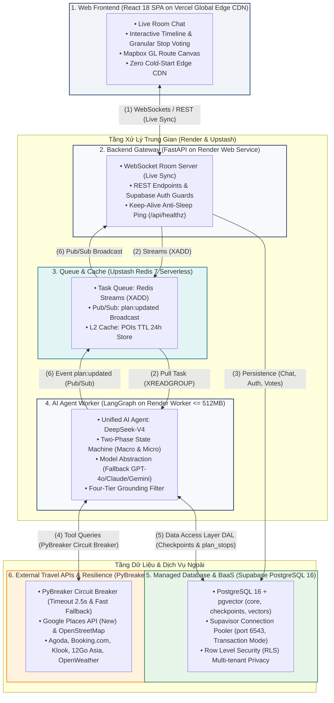
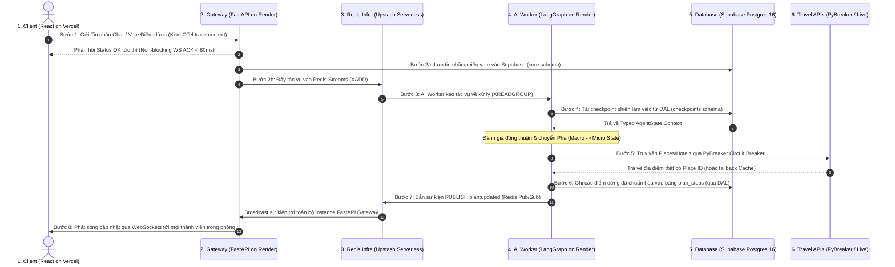

# 🏗️ System Architecture & Cloud Engineering
## Dự án: TripMate AI — Intelligent Group Activity & Travel Planning Platform

> Tài liệu chuẩn hóa kiến trúc tổng thể, các phân tầng thành phần, nền tảng triển khai đám mây, 6 giao diện kết nối (Interfaces 1--6) và luồng thực thi 8 bước của hệ thống TripMate AI, bám sát 100% Hình 4, Hình 5 và Bảng 2 trong Technical Proposal.

---

## ☁️ 1. Sơ Đồ Kiến Trúc Hệ Thống Tổng Thể (System Architecture & Interfaces)

Hệ thống TripMate AI áp dụng mô hình kiến trúc phi tập trung, bất đồng bộ và kháng lỗi cao, kết nối 6 phân tầng thành phần chính phân bổ trên các nền tảng điện toán đám mây:

---

## 🔌 2. Chi Tiết 6 Giao Diện Kết Nối Hệ Thống (Interfaces 1--6)

| Giao diện | Thành phần kết nối | Giao thức / Phương thức | Mục đích & Nghiệp vụ |
|:---:|---|:---:|---|
| **(1)** | **Frontend $\leftrightarrow$ Backend Gateway** | **WebSockets (`WSS`) / HTTPS REST** | Truyền tin nhắn phòng chat, gửi phiếu bình chọn điểm dừng (Vote UP/DOWN), gửi lệnh 1-Click Swap, và nhận luồng đồng bộ tức thì (<80ms ACK). |
| **(2)** | **Gateway $\rightarrow$ Redis $\rightarrow$ AI Worker** | **Redis Streams (`XADD` / `XREADGROUP`)** | Hàng đợi tác vụ bất đồng bộ. Gateway đẩy task vào Redis Streams không chặn người dùng; LangGraph AI Worker kéo task về thực thi. |
| **(3)** | **Gateway $\rightarrow$ Supabase Database** | **SQLAlchemy Async / PostgreSQL (core schema)** | Lưu vết tức thì lịch sử tin nhắn phòng chat, thông tin người dùng, quyền hạn thành viên và số lượt bình chọn. |
| **(4)** | **AI Worker $\leftrightarrow$ External Travel APIs** | **HTTPX Async qua PyBreaker Circuit Breaker** | Truy vấn địa điểm thực tế từ Google Places API, khách sạn, hoạt động Klook với cơ chế ngắt mạch tự động (timeout 2.5s). |
| **(5)** | **AI Worker $\leftrightarrow$ Supabase Database** | **Data Access Layer (DAL) / AsyncPostgresSaver** | Nạp và lưu vết trạng thái `AgentState` vào schema `checkpoints`; ghi các điểm dừng đã chuẩn hóa vào bảng `plan_stops`. |
| **(6)** | **AI Worker $\rightarrow$ Redis $\rightarrow$ Gateway** | **Redis Pub/Sub (`plan:updated`)** | Phát sóng sự kiện cập nhật lịch trình từ AI Worker tới mọi instance Gateway để chuyển tiếp xuống Frontend qua WebSockets. |

---

## ⚡ 3. Chu Trình Vận Hành End-to-End (8 Bước Thực Thi)

Quy trình thực thi tuần tự của hệ thống từ khi người dùng tương tác đến khi nhận được kết quả cập nhật:

### Bảng tóm tắt các bước theo Proposal:

| Bước | Giao diện | Chế độ | Phụ thuộc | Chức năng vận hành chi tiết |
|:---:|---|:---:|---|---|
| **1** | **(1)** Frontend $\rightarrow$ Gateway | Sync | Thao tác người dùng | Truyền tin nhắn chat hoặc vote điểm dừng kèm OpenTelemetry trace context. |
| **2a** | **(3)** Gateway $\rightarrow$ Database | Sync | Bước 1 | Lưu vết tin nhắn phòng và số phiếu vote vào Supabase (`core` schema). |
| **2b** | **(2)** Gateway $\rightarrow$ Redis (Streams) | Async | Bước 1 | Đẩy tác vụ bất đồng bộ vào Redis Streams (`XADD`); trả về HTTP/WS ACK ngay lập tức. |
| **3** | **(2)** Redis (Streams) $\rightarrow$ AI Agent | Async | Bước 2b | LangGraph Worker kéo tác vụ về xử lý qua Consumer Group (`XREADGROUP`). |
| **4** | **(5)** AI Agent $\leftarrow$ Database | Async | Bước 3 | Tải checkpoint phiên làm việc và ngữ cảnh phòng từ schema `checkpoints` qua DAL. |
| **4b** | LangGraph State Transition | Internal | Bước 4 | Đánh giá điều kiện đồng thuận và chuyển đổi giữa Macro State và Micro State. |
| **5** | **(4)** AI Agent $\leftrightarrow$ Travel APIs | Parallel | Bước 4b | Gọi Google Places/Agoda qua PyBreaker; tự động lấy từ L2 Cache nếu API ngoài lỗi. |
| **6** | **(5)** AI Agent $\rightarrow$ Database | Async | Bước 5 | Ghi các điểm dừng đã kiểm chứng và chuẩn hóa vào bảng `plan_stops` qua DAL. |
| **7** | **(6)** AI Agent $\rightarrow$ Redis $\rightarrow$ Gateway | Async | Bước 6 | Bắn sự kiện `PUBLISH plan:updated` qua Redis Pub/Sub để đồng bộ các node Gateway. |
| **8** | **(1)** Gateway $\rightarrow$ Frontend | Push | Bước 7 | Phát sóng lộ trình mới nhất qua WebSockets tới tất cả thành viên trong phòng. |

---

## 🌧️ 4. Minh Họa Kịch Bản: Lịch Trình Tự Động Thích Ứng Khi Trời Mưa (Dynamic On-The-Go Adaptation)

Để chứng minh sức mạnh của kiến trúc phân tầng bất đồng bộ, hãy xem xét kịch bản nhóm đang đi chơi thì gặp mưa to bất chợt:

1. **Người dùng nhắn tin**: Một thành viên nhắn vào chat: *"Trời đang mưa to quá, tìm giúp quán cafe trong nhà gần đây"*.
2. **Gateway phản hồi tức thì**: FastAPI Gateway nhận tin qua WebSocket, trả về ACK `< 80$\,ms, ghi tin nhắn vào bảng `chat_messages` (Supabase `core` schema, Bước 2a) và đẩy task vào Redis Streams (Bước 2b).
3. **AI Worker xử lý ngầm**: LangGraph Worker kéo task về (Bước 3), khôi phục phiên làm việc từ `checkpoints` schema (Bước 4), chuyển thẳng vào **Phase 2 Micro Curation State** (Bước 4b).
4. **Truy vấn địa điểm trong nhà**: AI gọi Google Places API tìm các quán cafe có tiện ích trong nhà nằm trong bán kính $\le 1.5$\,km qua PyBreaker (Bước 5).
5. **Cập nhật nguyên tử 1 dòng**: AI Agent ghi đè **duy nhất 1 dòng bản ghi điểm dừng bị ảnh hưởng** trong bảng `plan_stops` (Bước 6). Toàn bộ các điểm dừng của các ngày khác được giữ nguyên 100%.
6. **Đồng bộ thời gian thực**: AI Worker bắn sự kiện `plan:updated` qua Redis Pub/Sub (Bước 7), FastAPI Gateway nhận sự kiện và phát sóng ngay lập tức tới điện thoại của tất cả các thành viên qua WebSockets (Bước 8). Bản đồ Mapbox trên máy người dùng tự động vẽ lại lộ trình mới!

---

## 🛡️ 5. Độ Bền Vận Hành & Khả Năng Mở Rộng Hành Tinh (Planet-Scale Readiness)

- **Vercel Edge CDN**: Phân phối tài nguyên tĩnh và giao diện React 18 trên hơn 300 điểm PoP toàn cầu, thời gian nạp trang $< 100$\,ms, zero cold-start.
- **Render Stateless Workers**: Cả FastAPI Gateway và LangGraph Worker đều là tiến trình phi trạng thái (stateless), có thể scale ngang (horizontal scaling) thêm instance bất cứ lúc nào.
- **Supavisor Connection Pooling**: Cụm pooler hoạt động ở port 6543 (Transaction Mode) giúp xử lý an toàn hơn 200 phiên client đồng thời chỉ với 15 kết nối vật lý tới PostgreSQL, ngăn ngừa lỗi `connection limit exceeded`.
- **PyBreaker Resilience**: Đảm bảo lỗi từ phía Google Places hay Agoda không bao giờ làm treo hay crash hệ thống backend của dự án.
