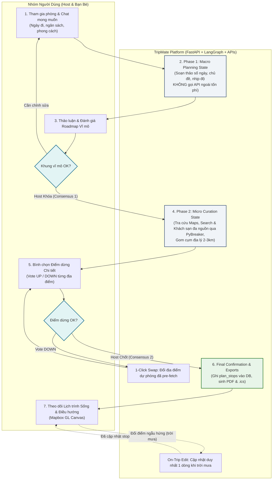
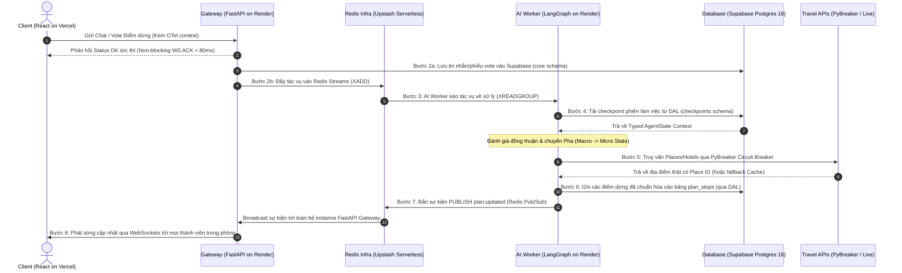

# 📖 Hướng Dẫn Vận Hành & Luồng Hoạt Động (TripMate AI System Explanation)

> Tài liệu giải thích chi tiết toàn bộ luồng nghiệp vụ, kiến trúc vận hành hệ thống, cơ chế phối hợp giữa các tầng công nghệ và nguyên lý của **AI Agent hợp nhất (DeepSeek-V4)** trong dự án **TripMate AI: Intelligent Group Activity & Travel Planning Platform**, bám sát 100% tài liệu Technical Proposal.

---

## 🗺️ 1. Bản Đồ Tài Liệu Kỹ Thuật (Documentation Directory Map)

- **Quy trình làm việc & Tracking bắt buộc**: [post-task-documentation.md](docs/01-workflow/post-task-documentation.md) (*No Docs = Not Done*).
- **Quy trình làm việc song song**: [contract-first-workflow.md](docs/01-workflow/contract-first-workflow.md) (Cơ chế code song song 6 người từ Sprint 0).
- **Phân vai trò & Ma trận RACI**: [team-roles.md](docs/00-overview/team-roles.md).
- **Tổng quan công nghệ & Cloud**: [tech-stack.md](docs/00-overview/tech-stack.md).
- **Kiến trúc hệ thống tổng thể**: [system-architecture.md](docs/03-architecture/system-architecture.md) (Sơ đồ 6 Interface và 8 Bước xử lý).
- **Kiến trúc AI Agent hợp nhất**: [ai-agent-architecture.md](docs/03-architecture/ai-agent-architecture.md) (LangGraph Two-Phase State Machine & Four-Tier Grounding).
- **Mô hình cơ sở dữ liệu**: [database-schema.md](docs/03-architecture/database-schema.md) (Supabase PostgreSQL 16, Supavisor connection pooler).
- **Hướng dẫn triển khai đám mây**: [deployment-guide.md](docs/03-architecture/deployment-guide.md) (Vercel, Render, Supabase, Upstash Redis).
- **Bảo mật & Phòng thủ AI**: [security-guidelines.md](docs/05-security/security-guidelines.md) (RLS, Atomic voting, Input sanitization).
- **Tiến độ & Danh mục micro-tasks**: [TASKS.md](docs/TASKS.md) & [task-board.md](docs/04-tasks/task-board.md).

---

## 💡 2. Luồng Nghiệp Vụ Cốt Lõi: Quy Trình Đồng Thuận 2 Giai Đoạn (Two-Stage Consensus Flow)

Khác với các công cụ lập kế hoạch truyền thống thường bắt người dùng chat qua lại hàng chục lần hoặc tự xếp lịch thủ công, TripMate AI dẫn dắt cả nhóm qua **Quy trình đồng thuận 2 giai đoạn** với 2 chốt chặn khóa kế hoạch minh bạch:

### Bước 1: Thu thập mong muốn nhóm (Desires Capture)
- Thành viên tham gia phòng qua Link chia sẻ mà không cần cài đặt ứng dụng phức tạp.
- Nhóm thảo luận tự do trong màn hình Room Chat: ngày dự kiến, mức ngân sách, mong muốn đặc biệt (ăn chay, thích cafe view đẹp, thích vận động). Mọi tin nhắn được lưu trực tiếp vào Supabase (`core` schema).

### Bước 2: Pha 1 — Lập Kế Hoạch Vĩ Mô (Phase 1: Macro Planning)
- Khi nhận yêu cầu, AI Agent khởi động **Phase 1 Macro State** trên LangGraph Python.
- AI tổng hợp mong muốn và đề xuất khung chương trình: phân chia các ngày, chủ đề chính của từng buổi (ví dụ: *Sáng Day 1: Khám phá phố cổ; Chiều: Check-in bán đảo Sơn Trà; Tối: Thưởng thức hải sản*).
- **Điểm đột phá kỹ thuật**: Ở pha này, AI **hoàn toàn không gọi API bên thứ 3 tốn kém** (Google Places/Agoda), giúp tiết kiệm token và phản hồi nhanh ($6$--$12$\,giây).

### Bước 3: Đồng thuận Vĩ mô (Consensus Checkpoint 1: Macro Lock)
- Cả nhóm xem khung chương trình. Nếu chưa ưng ý, thành viên chat thêm để AI điều chỉnh.
- Khi nhóm thống nhất, **Host bấm nút Khóa Lộ Trình Vĩ Mô (Macro Lock)**. Đây là chốt chặn đồng thuận thứ nhất, cho phép hệ thống chuyển sang pha tuyển chọn chi tiết.

### Bước 4: Pha 2 — Tuyển chọn Địa Điểm Chi Tiết (Phase 2: Micro Curation)
- Được kích hoạt ngay sau khi Macro Lock.
- AI Agent gọi các công cụ kết nối API ngoài (**Google Maps, Google Search, Google Hotels, TripAdvisor, Airbnb, Trip.com, Hotels.com, Trivago, Expedia, Klook**) thông qua bộ chuyển đổi Adapter Pattern và lớp ngắt mạch **PyBreaker Circuit Breaker** (timeout 2.5s).
- **Thuật toán Gom Cụm Địa Lý (Smart Geo-Clustering)**: Sử dụng công thức khoảng cách Haversine và Mapbox Matrix để gom các địa điểm trong cùng một buổi sáng/chiều vào bán kính hẹp $2.0$--$2.5$\,km ($\le 20$\,phút di chuyển), ngăn chặn tuyệt đối tình trạng di chuyển hình ziczac qua lại giữa hai đầu thành phố.
- AI nạp sẵn 2 địa điểm dự phòng cho mỗi điểm dừng chính để chuẩn bị cho cơ chế 1-click swap.

### Bước 5: Bình chọn Từng Điểm Dừng & Đổi Dự Phòng (Granular Stop Voting & 1-Click Swap)
- Từng điểm dừng hiển thị thành các thẻ trực quan (thời gian ghé thăm, hình ảnh thật, đánh giá, chi phí dự kiến).
- Các thành viên trong phòng vote **UP** (đồng ý) hoặc **DOWN** (không thích).
- Nếu một địa điểm bị phản đối, người dùng chỉ cần nhấn **1-Click Swap**, hệ thống sẽ ngay lập tức thay thế bằng địa điểm dự phòng đã được xác thực sẵn mà không cần AI phải suy luận lại từ đầu (thời gian swap chỉ $3$--$6$\,giây).

### Bước 6: Chốt Kế Hoạch Chính Thức (Consensus Checkpoint 2: Final Lock)
- Khi mọi điểm dừng đều đạt tỷ lệ đồng thuận cao, Host bấm nút **Xác nhận Kế Hoạch Chính Thức (Final Lock)**.
- Backend FastAPI ghi toàn bộ danh sách điểm dừng đã chuẩn hóa vào bảng `plan_stops` trong PostgreSQL.
- Hệ thống hỗ trợ xuất file **PDF lịch trình chi tiết** (WeasyPrint) và đồng bộ **File Lịch (.ics)** vào Google Calendar / Apple Calendar.
- Lộ trình định tuyến được hiển thị đồng bộ trên bản đồ Mapbox GL Canvas.

### Bước 7: Lịch Trình Sống Động & Tự Động Thích Ứng (Living Itinerary & Dynamic Adaptation)
- Sau khi chốt, kế hoạch không bị "chết" cứng. Trong suốt chuyến đi thực tế, nếu gặp biến cố (ví dụ: *trời đổ mưa to bất chợt*), một thành viên nhắn vào chat: *"Trời đang mưa to, đổi quán cafe trong nhà gần đây"*.
- Hệ thống xử lý thông minh: AI Agent tải lại checkpoint phiên làm việc từ Supabase, chuyển thẳng vào Micro State, tìm quán cafe trong nhà gần vị trí hiện tại, và **chỉ cập nhật duy nhất 1 dòng bản ghi trong bảng `plan_stops`**, sau đó phát sóng qua WebSockets tới mọi thành viên. Lịch trình của các buổi khác hoàn toàn không bị ảnh hưởng!

---

## 🤖 3. AI Agent Hợp Nhất & Hàng Rào Chống Ảo Giác (Grounding Pipeline)

### 3.1. Vì Sao Dùng AI Agent Hợp Nhất Thay Vì Đa Agent Rời Rạc?
Trong nhiều đồ án thử nghiệm, việc chia nhỏ thành 8--9 sub-agent (Location Agent, Cost Agent, Note Agent, Research Agent...) dẫn đến:
- **Nghẽn độ trễ nghiêm trọng**: Phải chuyển giao context qua lại giữa nhiều agent, mỗi lần gọi LLM mất thêm vài giây.
- **Rủi ro trôi ngữ cảnh (Context Drift)**: Agent này không hiểu trọn vẹn mong muốn mà agent trước đã tiếp nhận.
- **Chi phí token nhân bội**: Mỗi agent phải load lại system prompt và conversation history.

**Giải pháp của TripMate AI**: Sử dụng **1 AI Agent hợp nhất duy nhất chạy mô hình DeepSeek-V4 trên LangGraph Python**, vận hành tuần tự qua 2 pha trạng thái (**Two-Phase State Machine**) rõ ràng:
1. **Macro Planning State**: Suy luận logic, phân bổ thời gian và chủ đề.
2. **Micro Curation State**: Gọi công cụ, lọc dữ liệu thực tế, tính khoảng cách địa lý.

### 3.2. Model Abstraction Layer (Chống Phụ Thuộc Nhà Cung Cấp)
Hệ thống xây dựng một lớp trừu tượng hóa mô hình LLM:
- **Primary Engine**: **DeepSeek-V4** — năng lực suy luận chuyên sâu, chi phí cực kỳ tiết kiệm.
- **Transparent Fallback**: Khi DeepSeek API gặp sự cố quá tải hoặc rate limit, lớp trừu tượng tự động chuyển luồng sang **OpenAI (GPT-4o)**, **Anthropic Claude 3.5**, hoặc **Google Gemini 1.5 Pro** mà không làm đứt đoạn phiên làm việc của người dùng.

### 3.3. Four-Tier Grounding Pipeline (Bảo Đảm 0% Địa Điểm Ảo)
Để giải quyết triệt để vấn đề muôn thuở của AI là "bịa đặt địa điểm" (hallucination), TripMate AI bắt buộc mọi đề xuất phải đi qua 4 tầng kiểm chứng:

1. **Tier 1 — Strict Pydantic Schema**: Mọi phản hồi từ LLM phải parse thành công vào Pydantic schema với kiểu dữ liệu chặt chẽ (tên địa điểm, danh mục `StopCategory`, vĩ độ/kinh độ ước tính, khung giá). Nếu sai cấu trúc, parser tự động yêu cầu sửa đổi thay vì làm crash ứng dụng.
2. **Tier 2 — Live Map Check**: Kiểm tra chéo từng địa điểm với Google Places API và OpenStreetMap (OSM) để xác thực sự tồn tại, lấy Place ID chuẩn xác, kiểm tra trạng thái mở cửa và khung giờ hoạt động thực tế.
3. **Tier 3 — Distance Guard (Bảo Vệ Cự Ly)**: Áp dụng thuật toán Haversine và Mapbox Matrix API để kiểm tra: khoảng cách giữa 2 điểm dừng liên tiếp trong cùng 1 buổi phải $\le 2.5$\,km và thời gian di chuyển $\le 20$\,phút. Nếu vượt quá, AI tự động loại bỏ và chọn địa điểm khác gần hơn.
4. **Tier 4 — Member Votes & 1-Click Backup**: Đặt quyền quyết định tối hậu vào tay người dùng. Từng thành viên bỏ phiếu UP/DOWN; điểm dừng bị từ chối được thay thế ngay bằng phương án dự phòng đã được xác thực qua 3 tầng trước đó.

---

## ⚡ 4. Luồng Thực Thi Hoạt Động Từ Đầu Đến Cuối (End-to-End Operational Flow)

Kiến trúc vận hành giữa 6 thành phần hệ thống thông qua các giao diện **(1)--(6)** và 8 bước xử lý:

### Bảng tóm tắt các bước thực thi:

| Bước | Giao diện | Phương thức | Phụ thuộc | Chức năng vận hành |
|:---:|---|:---:|---|---|
| **1** | **(1)** Frontend $\rightarrow$ Gateway | Sync | Thao tác người dùng | Truyền tin nhắn chat hoặc vote điểm dừng kèm OpenTelemetry trace context. |
| **2a** | **(3)** Gateway $\rightarrow$ Database | Sync | Bước 1 | Lưu vết tin nhắn và số lượt vote vào Supabase (`core` schema). |
| **2b** | **(2)** Gateway $\rightarrow$ Redis (Streams) | Async | Bước 1 | Đẩy task vào Redis Streams (`XADD`); trả về HTTP/WS ACK ngay lập tức. |
| **3** | **(2)** Redis (Streams) $\rightarrow$ AI Agent | Async | Bước 2b | LangGraph Worker kéo task về xử lý qua Consumer Group (`XREADGROUP`). |
| **4** | **(5)** AI Agent $\leftarrow$ Database | Async | Bước 3 | Tải checkpoint và ngữ cảnh phòng từ schema `checkpoints` qua DAL. |
| **4b** | LangGraph State Transition | Internal | Bước 4 | Đánh giá điều kiện đồng thuận và chuyển đổi giữa Macro State và Micro State. |
| **5** | **(4)** AI Agent $\leftrightarrow$ Travel APIs | Parallel | Bước 4b | Gọi Google Places/Agoda qua PyBreaker; tự động lấy từ L2 Cache nếu API ngoài lỗi. |
| **6** | **(5)** AI Agent $\rightarrow$ Database | Async | Bước 5 | Ghi các điểm dừng đã kiểm chứng và chuẩn hóa vào bảng `plan_stops` qua DAL. |
| **7** | **(6)** AI Agent $\rightarrow$ Redis $\rightarrow$ Gateway | Async | Bước 6 | Bắn sự kiện `PUBLISH plan:updated` qua Redis Pub/Sub để đồng bộ các node Gateway. |
| **8** | **(1)** Gateway $\rightarrow$ Frontend | Push | Bước 7 | Phát sóng lộ trình mới nhất qua WebSockets tới tất cả thành viên trong phòng. |

---

## 🎯 5. Hai Phạm Vi Kế Hoạch Linh Hoạt (Dual Planning Scopes)

TripMate AI hỗ trợ 2 kịch bản sử dụng thực tế:

### 5.1. Đi Chơi Trong Ngày (Day Hangouts)
- **Mục tiêu**: Lên kèo tụ tập nhanh cho buổi chiều hoặc tối cuối tuần.
- **Kịch bản**: *"Nhóm 4 người, chiều thứ 7 hẹn cafe view rooftop Quận 1 lúc 15h, sau đó chơi board game, tối ăn lẩu bò, ngân sách 300k/người"*.
- **Cơ chế xử lý**: Bỏ qua việc tìm khách sạn; ưu tiên tối đa các địa điểm đang mở cửa, khoảng cách giữa các điểm $\le 1.5$\,km, kiểm tra chỗ gửi xe và giá menu trung bình.

### 5.2. Kỳ Nghỉ Nhiều Ngày (Multi-Day Vacations)
- **Mục tiêu**: Lập kế hoạch du lịch hoàn chỉnh cho nhóm bạn hoặc gia đình.
- **Kịch bản**: *"Chuyến đi Đà Nẵng - Hội An 4 ngày 3 đêm cho nhóm 6 người, thích trải nghiệm ẩm thực địa phương, tắm biển, có người già nên di chuyển thong thả, ngân sách 6 triệu/người"*.
- **Cơ chế xử lý**: 
  - Giai đoạn vĩ mô: Chia Day 1 (Đà Nẵng), Day 2 (Bà Nà Hills), Day 3 (Hội An phố cổ), Day 4 (Mua sắm đặc sản & về).
  - Giai đoạn vi mô: Gợi ý khách sạn trung tâm, xếp tuyến tham quan theo buổi, gom cụm bán kính $\le 2.5$\,km, tính toán chi phí di chuyển xe đưa đón qua 12Go Asia / Grab.

---

## 🛡️ 6. Bảo Mật Đa Tầng, Quyền Riêng Tư & Kiểm Soát Con Người (Human-in-the-Loop)

1. **Nguyên tắc Con người Quyết định Tối hậu (Human-in-the-Loop)**: AI không bao giờ tự ý chốt kế hoạch chính thức. AI chỉ đóng vai trò người trợ lý tạo bản nháp và tính toán phương án tối ưu. **Chỉ có Host của phòng mới có quyền bấm Khóa Kế Hoạch (Lock)**.
2. **Cách Ly Dữ Liệu Bằng Supabase Row Level Security (RLS)**: Các chính sách RLS ở tầng database đảm bảo người dùng chỉ có thể đọc và ghi dữ liệu thuộc về phòng mà họ đã tham gia hợp lệ (`event_members`).
3. **Bình Chọn Bất Khả Xâm Phạm (Atomic Voting)**: Sử dụng các câu lệnh cập nhật SQL nguyên tử (`UPDATE ... WHERE ...`) và Redis transaction để triệt tiêu hoàn toàn tình trạng race condition khi nhiều thành viên cùng bấm vote tại một phần nghìn giây.
4. **Phòng Chống Prompt Injection**: Toàn bộ nội dung chat từ người dùng được làm sạch (sanitization) qua Pydantic v2 và thư viện bảo mật trước khi đưa vào template prompt của LLM. Tách biệt hoàn toàn giữa vai trò `system` và `user`.
5. **Khôi Phục Phiên Tự Động (Session Recovery)**: Trạng thái của LangGraph được checkpoint liên tục vào Supabase. Nếu container AI Worker trên Render bị restart đột ngột, tác vụ sẽ tự động khôi phục chính xác từ checkpoint gần nhất mà không làm mất dữ liệu của người dùng.

---

## 🏛️ 7. Chuẩn Mực Thiết Kế Ứng Dụng: Architecture Patterns, Modular Design & Bộ Ba Tiêu Chí Kỹ Thuật

TripMate AI được xây dựng theo chuẩn mực kỹ thuật cao cấp của một ứng dụng quy mô lớn, thỏa mãn trọn vẹn: **Dễ Maintain, Dễ Dev, Dễ Hiểu**:

### 7.1. Kiến Trúc Ứng Dụng Phân Tầng (Clean / Layered Architecture)
- **FastAPI Backend**:
  - `api/`: Transport Layer, nhận HTTP/WS request, validate JWT, bắt lỗi ngoại lệ chuẩn hóa.
  - `services/`: Domain Logic Layer, giải quyết bài toán nghiệp vụ, điều phối Two-Stage Consensus, thuật toán Min-Cash-Flow.
  - `dal/` (Data Access Layer): Repository Layer thao tác cơ sở dữ liệu qua SQLAlchemy 2.0 Async.
  - `adapters/`: Travel Provider Layer, cô lập toàn bộ các kết nối API du lịch và khách sạn bên ngoài.
- **React Frontend**:
  - `features/`: Chia nhỏ theo miền nghiệp vụ (`event-planning`, `ai-chat`, `finance`).
  - `components/ui/`: Atomic Presentation components xây dựng trên shadcn/ui.
  - `hooks/`: Custom Hooks đóng gói toàn bộ stateful logic và side effects.
  - `stores/`: Quản lý client state toàn cục qua Zustand.

### 7.2. Tầng Chuyển Đổi Dịch Vụ Du Lịch (Pluggable Adapter & Strategy Pattern)
- Tích hợp mạng lưới đối tác rộng lớn: **Google Maps (Places API), Google Search, Google Hotels, TripAdvisor, Airbnb, Trip.com, Hotels.com, Trivago, Expedia**.
- Mọi provider đều kế thừa `BaseTravelProvider`, đảm bảo khi thay đổi API key hoặc thêm nhà cung cấp mới, toàn bộ luồng AI Agent và hiển thị UI không cần thay đổi dù chỉ một dòng code.

### 7.3. Giao Diện Flexbox & Đáp Ứng Đa Thiết Bị (Flexbox & Fully Responsive UI)
- **Flexbox-First**: 100% bố cục dùng `display: flex` và CSS Grid.
- **Responsive Layout**:
  - Mobile (375px+): Giao diện 1 cột, ngăn kéo (drawer/bottom-sheet) kéo thả mượt mà, touch target chuẩn $\ge 44 \times 44$\,px.
  - Tablet (768px+): Bố cục 2 cột tối ưu.
  - Desktop (1024px+ / 1440px+): Split-pane 3 cột song song (Chat - Timeline/Voting - Mapbox GL Canvas) đồng bộ thời gian thực, không giật lag.

### 7.4. Ba Trụ Cột Kỹ Thuật: Dễ Maintain, Dễ Dev, Dễ Hiểu
- 🛠️ **Dễ Maintain (Maintainable)**: Tuân thủ SOLID, DRY, KISS, hàm ngắn ($\le 30$ dòng), circuit breaker PyBreaker tự phục hồi.
- 💻 **Dễ Dev (High DX)**: Contract-First từ Sprint 0, OpenAPI spec chuẩn chỉnh, MSW mocking độc lập, TypeScript strict + Pydantic v2 type safety 100%.
- 📖 **Dễ Hiểu (Readable)**: Naming convention rõ ràng, code tự thuyết minh (self-documenting), hệ thống tài liệu Docs-as-Code bám sát 100% Technical Proposal.
