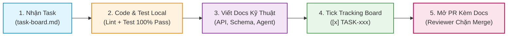

# 🗺️ Hướng Dẫn Bắt Đầu & Lộ Trình Đọc Tài Liệu (guides.md)
## Dự án: TripMate AI — Intelligent Group Activity & Travel Planning Platform

> Chào mừng bạn đến với dự án **TripMate AI**!  
> Để mọi thành viên trong nhóm 6 người (**Tạ Quang Huy, Hà Đăng Huy, Phạm Đình Ánh Dương, Nguyễn Minh Đức, Nguyễn Tùng Dương, Đinh Tiến Luân**) và người đánh giá/giảng viên có thể nắm bắt nhanh dự án trong vòng **15 phút**, vui lòng đọc theo lộ trình phân vai dưới đây.

---

## 🧭 1. Bạn Là Ai? Chọn Lộ Trình Đọc Docs (15 Phút Theo Vai Trò)

### 🅰️ Giảng Viên / Mentor / Người Đánh Giá (Evaluator & Supervisor)
> **Mục tiêu**: Nắm trọn vẹn bài toán, giải pháp kiến trúc, tính khả thi kỹ thuật và các chỉ số đo lường hiệu năng.

1. Đọc **[README.md](README.md)** (2 phút) — Tổng quan dự án, đội ngũ 6 thành viên, điểm nhấn kỹ thuật.
2. Đọc **[project-overview.md](docs/00-overview/project-overview.md)** (4 phút) — Nỗi đau thực tế, Quy trình đồng thuận 2 giai đoạn (Two-Stage Consensus), KPIs hệ thống.
3. Đọc **[explain.md](explain.md)** (4 phút) — Luồng nghiệp vụ chi tiết, Unified AI Agent (DeepSeek-V4), Hàng rào kiểm chứng 4 tầng (Four-Tier Grounding) và sơ đồ tuần tự 8 bước.
4. Đọc **[system-architecture.md](docs/03-architecture/system-architecture.md)** (3 phút) — Sơ đồ kiến trúc đám mây (Vercel, Render, Supabase, Upstash Redis).
5. Mở **[TASKS.md](docs/TASKS.md)** (2 phút) — Bảng phân rã công việc chi tiết đến từng file và tiêu chí nghiệm thu.

---

### 🅱️ Person 1 — Tạ Quang Huy (Backend Dev A: Core Domain & AI Integration)
> **Mục tiêu**: Nắm vững DB schema Supabase (`core`, `checkpoints`), Supavisor pooler port 6543, Two-Stage Consensus APIs, Data Access Layer (DAL) Bridge cho AI Agent, và WebSocket Room Server.

1. Đọc **[contract-first-workflow.md](docs/01-workflow/contract-first-workflow.md)** (3 phút) — Quy tắc chốt API contract để cả team code song song từ Ngày 1.
2. Đọc **[post-task-documentation.md](docs/01-workflow/post-task-documentation.md)** (3 phút) — **Bắt buộc**: Quy trình viết tài liệu và tick tracking sau mỗi task.
3. Đọc **[database-schema.md](docs/03-architecture/database-schema.md)** (5 phút) — Nắm kỹ các bảng: `users`, `events`, `event_members`, `plans`, `plan_stops`, `plan_votes`, `chat_messages`.
4. Đọc **[api-design-guide.md](docs/02-standards/api-design-guide.md)** (2 phút) — Nắm các endpoints Two-Stage Consensus (`/macro-lock`, `/stops/{id}/vote`, `/stops/{id}/swap`, `/final-lock`).
5. Mở **[person-1-backend-core.md](docs/04-tasks/person-1-backend-core.md)** (2 phút) — Kiểm tra danh mục task cá nhân được phân công.

---

### 🅲️ Person 2 — Hà Đăng Huy & Phạm Đình Ánh Dương (Backend Platform & Services)
> **Mục tiêu**: Nắm kỹ thuật tích hợp External Travel APIs, PyBreaker Circuit Breaker, Upstash Redis Cache (Hà Đăng Huy) và Supabase Auth, Invitations, Email SMTP, WeasyPrint PDF, .ics Calendar, Quản lý chi phí & Settlement (Phạm Đình Ánh Dương).

1. Đọc **[contract-first-workflow.md](docs/01-workflow/contract-first-workflow.md)** (3 phút) — Quy tắc cung cấp API spec cho Frontend và AI Agent.
2. Đọc **[post-task-documentation.md](docs/01-workflow/post-task-documentation.md)** (3 phút) — **Bắt buộc**: Cập nhật docs và tracking khi hoàn thành task.
3. Đọc **[tech-stack.md](docs/00-overview/tech-stack.md)** & **[system-architecture.md](docs/03-architecture/system-architecture.md)** (4 phút) — Nắm cơ chế ngắt mạch PyBreaker (timeout 2.5s) và Redis Streams/PubSub.
4. Đọc **[database-schema.md](docs/03-architecture/database-schema.md)** (3 phút) — Nắm cấu trúc 3 bảng tài chính: `expenses`, `expense_splits`, `settlements`.
5. Mở **[person-2-backend-platform.md](docs/04-tasks/person-2-backend-platform.md)** (2 phút) — Kiểm tra danh mục task cá nhân được phân công.

---

### 🅳️ Person 3 — Nguyễn Tùng Dương & Tạ Quang Huy (AI Agent Team: LangGraph & DeepSeek-V4)
> **Mục tiêu**: Nắm vững kiến trúc Unified AI Agent trên LangGraph Python, Máy trạng thái 2 pha (Phase 1: Macro State, Phase 2: Micro State), Model Abstraction Layer (DeepSeek-V4 + Fallback GPT-4o/Claude/Gemini), Four-Tier Grounding Pipeline và Typed Checkpointing.

1. Đọc **[ai-agent-architecture.md](docs/03-architecture/ai-agent-architecture.md)** (6 phút) — Thiết kế đồ thị LangGraph, Two-Phase State Machine, Model Abstraction Layer.
2. Đọc **[explain.md](explain.md)** Mục 3 (4 phút) — Hàng rào chống ảo giác 4 tầng (Four-Tier Grounding) và thuật toán gom cụm khoảng cách Haversine ($\le 2.5$\,km).
3. Đọc **[post-task-documentation.md](docs/01-workflow/post-task-documentation.md)** (3 phút) — Quy trình viết docs và tracking tiến độ.
4. Mở **[person-3-ai-engineer.md](docs/04-tasks/person-3-ai-engineer.md)** (2 phút) — Kiểm tra danh mục task cá nhân được phân công.

---

### 🅴️ Person 4 — Hà Đăng Huy (Frontend Dev A: Core Flows UI)
> **Mục tiêu**: Nắm mockup giao diện, cơ chế giả lập MSW (Mock Service Worker), màn hình Auth, Dashboard phòng, Dòng thời gian tương tác (Interactive Timeline), và Tích hợp bản đồ Mapbox GL Canvas.

1. Đọc **[contract-first-workflow.md](docs/01-workflow/contract-first-workflow.md)** (4 phút) — Dùng MSW mock dữ liệu để code UI ngay từ Ngày 1 mà không chờ Backend.
2. Đọc **[coding-conventions.md](docs/02-standards/coding-conventions.md)** (3 phút) — Chuẩn code React 18, TypeScript, Tailwind CSS, shadcn/ui.
3. Đọc **[post-task-documentation.md](docs/01-workflow/post-task-documentation.md)** (3 phút) — Quy trình cập nhật docs và tracking khi code xong UI.
4. Mở **[person-4-frontend-core.md](docs/04-tasks/person-4-frontend-core.md)** (2 phút) — Kiểm tra danh mục task cá nhân được phân công.

---

### 🅵️ Person 5 — Nguyễn Minh Đức (Frontend Dev B: AI Experience & Growth UI)
> **Mục tiêu**: Nắm UI màn hình Room Chat thời gian thực, cơ chế Token Streaming (TTFT $< 800$\,ms), Thẻ bình chọn điểm dừng (Stop Voting Cards UP/DOWN kèm 1-Click Swap), Design System, Đa ngôn ngữ (i18n), UI Quyết toán chi phí & Admin Dashboard.

1. Đọc **[explain.md](explain.md)** (4 phút) — Luồng tương tác người dùng qua 2 chốt chặn đồng thuận (Consensus 1 & 2) và kịch bản 1-Click Swap.
2. Đọc **[contract-first-workflow.md](docs/01-workflow/contract-first-workflow.md)** (4 phút) — Cách mock streaming response cho AI Chat UI bằng MSW.
3. Đọc **[post-task-documentation.md](docs/01-workflow/post-task-documentation.md)** (3 phút) — Quy trình cập nhật docs và tracking sau mỗi task UI.
4. Mở **[person-5-frontend-growth.md](docs/04-tasks/person-5-frontend-growth.md)** (2 phút) — Kiểm tra danh mục task cá nhân được phân công.

---

### 🅶️ Person 6 — Đinh Tiến Luân (Cyber Security & DevOps Engineer)
> **Mục tiêu**: Nắm hạ tầng Multi-Cloud (Vercel Edge CDN, Render Web Service/Worker, Supabase Postgres 16, Upstash Redis), CI/CD GitHub Actions, Cấu hình Keep-Alive ping `/api/healthz`, OpenTelemetry Tracing, Supabase RLS, OWASP Pentest, và Locust Stress Test.

1. Đọc **[deployment-guide.md](docs/03-architecture/deployment-guide.md)** (5 phút) — Cấu hình Blueprint `render.yaml`, `vercel.json`, kết nối Supabase pooler (port 6543) và Upstash Redis.
2. Đọc **[security-guidelines.md](docs/05-security/security-guidelines.md)** (4 phút) — RLS policies, Atomic voting, Input sanitization, Checkpoint recovery.
3. Đọc **[post-task-documentation.md](docs/01-workflow/post-task-documentation.md)** (3 phút) — Quy trình cập nhật docs và tracking khi hoàn thành task hạ tầng.
4. Mở **[person-6-security-devops.md](docs/04-tasks/person-6-security-devops.md)** (2 phút) — Kiểm tra danh mục task cá nhân được phân công.

---

## 💻 2. Hướng Dẫn Khởi Động Môi Trường Phát Triển Local (5 Phút)

### Bước 1: Clone Repository & Chuẩn Bị Môi Trường
```bash
git clone <repo-url>
cd Group_Project
```

### Bước 2: Khởi Động Backend Gateway & Database Local
```bash
cd backend
cp ../.env.example .env

# Khởi động PostgreSQL 15 & Redis 7 container
docker compose up -d

# Cài đặt thư viện Python bằng Poetry
poetry install

# Chạy migration database
poetry run alembic upgrade head

# Khởi động FastAPI server với auto-reload
poetry run uvicorn app.main:app --reload --port 8000
```
- Swagger API Docs: `http://localhost:8000/docs`
- Health Check: `http://localhost:8000/api/healthz`

### Bước 3: Khởi Động Frontend Single Page App
```bash
cd ../frontend
cp .env.example .env
pnpm install
pnpm run dev
```
- Giao diện người dùng: `http://localhost:5173`

---

## 🔄 3. Quy Trình Phối Hợp & Giám Sát Tiến Độ Bắt Buộc ("No Docs = Not Done")

Để đảm bảo toàn bộ nhóm 6 người phối hợp nhịp nhàng, minh bạch và theo dõi được tiến độ từng ngày:



1. **Daily Async Standup (Trước 10:00 AM)**: Gửi tin nhắn 3 dòng lên kênh `#daily-sync` (Hôm qua làm gì, hôm nay làm gì, có blocker gì không).
2. **Cập nhật Docs ngay trong PR**: Khi thêm API, cập nhật `api-design-guide.md`; khi đổi DB Model, cập nhật `database-schema.md`; khi đổi State AI, cập nhật `ai-agent-architecture.md`.
3. **Tick Tracking Board**: Commit tick `[x]` vào `docs/04-tasks/person-X-*.md` và `docs/TASKS.md`.
4. **Cổng kiểm duyệt Reviewer**: Reviewer chỉ bấm Approve khi PR thỏa mãn cả code sạch, test pass và tài liệu kỹ thuật đầy đủ.
